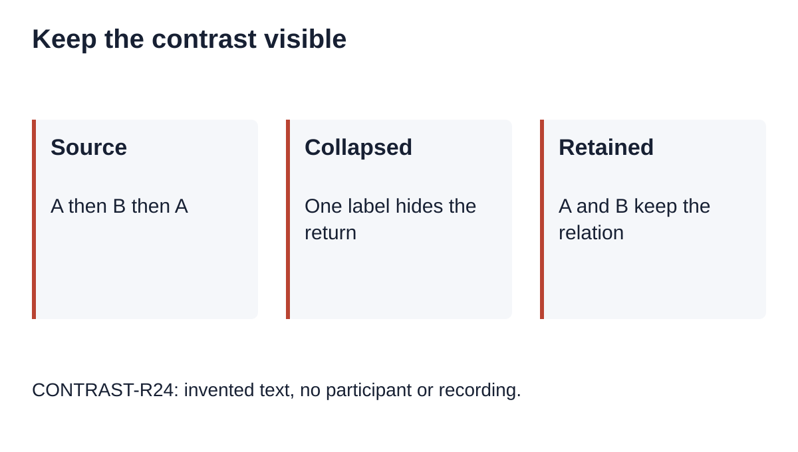
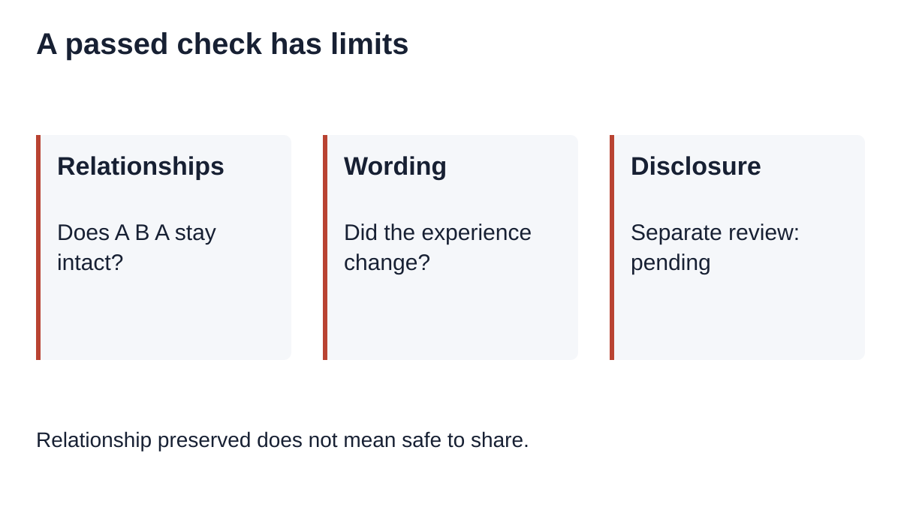

# Can Anonymizing Place Names Erase an Interview Contrast?

Canonical: <https://instascript.app/qualitative-anonymization-meaning>

Yes. In qualitative research transcription, replacing two different places with the same label can hide a comparison that matters to the analysis. Review what relationships the prepared passage still supports, alongside a separate disclosure review. Distinct placeholders can preserve a contrast, but neither distinct labels nor a successful text check establish that a transcript is safe to share.

[Download the meaning-review worksheet (CSV)](/data/qualitative-anonymization-meaning-worksheet.csv)

## What should the replacement preserve?

Start with the purpose of the passage. A researcher comparing experiences across two settings needs to know whether references concern the same setting or different settings. Exact names may be unnecessary. However, replacing every setting with one generic token can remove that distinction. Record the analytical relationship needed before choosing the replacement, rather than deciding that any readable sentence retains enough information.

[UK Data Service guidance](https://ukdataservice.ac.uk/learning-hub/data-producer-support/preparing-data-for-sharing-and-reuse/anonymising-data-and-protecting-participants/anonymisationfortextdata/) already addresses consistent substitutions and the loss of interpretive value through excessive removal. It also explains that remaining contextual details can identify someone. Our contribution is the small, inspectable contrast exercise below. It is a teaching example, not a new anonymization standard or an assessment of disclosure risk.

## Our fictional exercise: three names, two settings

Everything in CONTRAST-R24 is invented: the setting names, text, labels and declared relationships. There is no participant, recording or listening session. The source card V1 reads: “At Lumen Room I could ask privately. At Bracken Hall I had to speak in front of everyone. I went back to Lumen Room.” These names were invented for this exercise and do not refer to actual research sites.

The author declares the occurrence pattern A, B, A: the first and third references concern the same setting; the second concerns another setting. The passage contrasts private and public opportunities to speak. Those declarations provide an answer key for the exercise, not evidence about any real interview.

**Draft A — collapsed:** “At [setting] I could ask privately. At [setting] I had to speak in front of everyone. I went back to [setting].” The words about privacy remain, but a reader cannot recover which setting was revisited from these labels alone. The author marks the required relationship as lost. The draft does not prove that all events occurred in one place; the shared token is ambiguous.

**Draft B — relationship retained:** “At [setting A] I could ask privately. At [setting B] I had to speak in front of everyone. I went back to [setting A].” The labels preserve the declared A, B, A pattern. This earns only a relationship-preserved result in this exercise. Disclosure review stays pending. The distinctive story might still be identifying in a real project.

**Draft C — return mislinked:** “At [setting A] I could ask privately. At [setting B] I had to speak in front of everyone. I went back to [setting B].” Two different labels are present, yet the third reference now points to the wrong setting. Merely counting labels would miss the problem. Compare each occurrence and its relationship with the permitted source, not just the number of tokens.

## Our reproducible check: relationships are narrower than meaning

Download the [standalone Node exercise](/data/qualitative-anonymization-meaning-reproduce.cjs) and [fictional records with executed results](/data/qualitative-anonymization-meaning-example.json). Running the script prints the invented text and checks without reading research files or contacting a server. It tests pairs of occurrence labels against the declared A, B, A pattern. Both same-setting and different-setting relationships must match.

The checker accepts Draft B, rejects A's collapsed distinction and rejects C's changed return. It also tests a missing occurrence and the all-distinct pattern A, B, C, which loses the repeated reference. These are mechanical assertions against a tiny supplied answer key. They cannot discover places in a transcript, decide which distinctions matter, or assess whether a person could be identified.

Our fourth counterexample keeps B's labels but changes “privately” to “publicly.” Its relationship test still passes. The author explicitly rejects the changed wording for this exercise because it alters the stated experience. Code does not infer that meaning change: a separate exact-text comparison only reports that wording differs. Passing the relationship test therefore cannot approve the passage's meaning or release.

This separation is useful when reviewing a prepared copy. One field can record that occurrence relationships match. Another can record a wording discrepancy. A third can hold the contextual review decision. A fourth records disclosure review for the intended use. Combining these fields into one green check would claim more than the exercise establishes.

## Our worksheet: state the intended inference

Use the blank CSV within your project's approved storage. It is a downloadable form, not an upload interface or a secure project store. Record the source reference and version, prepared-copy version, passage reference, intended analytical use, required relationship and occurrence-level replacement plan. Keep any identifying replacement key in the project's separately protected records; this public worksheet should not be used to publish that key.

For this fictional passage, an intended-use entry could say “compare opportunities to ask a question in two settings.” The required relationship could say “first and third references are the same setting; second is different.” Record Draft B as relationship-preserved, wording-unchanged and disclosure-pending. Do not translate that row into “anonymous” or “approved for publication.” No actual human review has occurred in this example.

If even the distinction between settings would disclose too much, preserving it is not automatically the right choice. Follow the project's review process and document that the proposed shared passage cannot support the original comparison. Do not silently restore detail to make the analysis easier. The purpose of this exercise is to expose information loss and unresolved decisions, not prescribe the correct disclosure decision.

When a replacement changes, revisit linked extracts and the argument they support. Record the new version and the decision, including unresolved outcomes. A later reviewer should be able to see whether the comparison depended on information removed from the working copy. For source-link bookkeeping, use the separate [restricted source-locator guide](/qualitative-source-locators). For unknown text and deliberate quotation cuts, see [transcript omissions](/qualitative-quote-omissions).

## Must every place receive a different placeholder?

No. Choose a documented scheme appropriate to the permitted use and the required distinctions. The A/B labels are an answer key for this invented example, not a universal policy. A broad category may be sufficient for another research question. A more detailed label can also reveal information. Review the actual passage and audience rather than adopting this fixture's labels automatically.

## Does preserving the pattern prove anonymity?

No. The checker receives declared labels and tests relationships only. It does not inspect indirect identifiers, metadata, linked records, recipients or consent. A prepared passage can retain its analytical usefulness while remaining unsuitable to share. Keep that unresolved status visible and follow the project's disclosure-review arrangements.

## Can InstaScript anonymize or approve my transcript?

No. This is a manual guide with fictional practice material. InstaScript does not detect identifying details, manage replacement keys or approve research releases. Its [Audio to Text tool](/audio-to-text) creates English drafts from browser-decodable local files up to 100 MB. Actual decoding depends on the browser; first use downloads model resources, and cached resources may still require initialization. Local files and edits remain in the browser. Instagram fetching uses servers; YouTube tools retrieve existing captions and successful queries may be cached for one hour. See the [privacy policy](/privacy).
