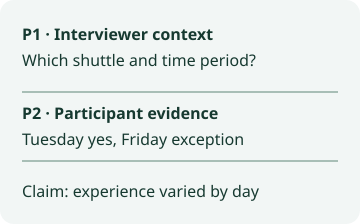
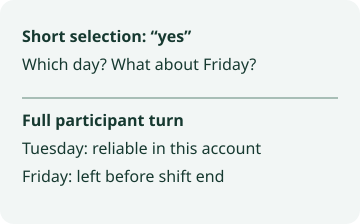

# How Much of an Interview Answer Should You Code?

Select the participant’s words that support the code, then separately record any interviewer prompt needed to interpret those words. Include a qualification in the coded selection when dropping it changes what the participant appears to claim. Check whether another reader can recover the claim from the selection and its recorded context.

[Download the coding worksheet](/data/qualitative-coding-evidence-worksheet.md)

## Try it with a fictional transit interview

In qualitative research transcription, keep speaker labels and turn locators so each selection can be traced to its transcript version. A coding selection is an analytic choice. The worksheet below gives you a place to explain it.

This is invented training text. There is no recording or study participant.

- P1, interviewer. “Was the late shuttle reliable after the timetable changed?”
- P2, participant. “On Tuesdays, yes. On Fridays it left before our shift ended.”
- P3, interviewer. “Did the driver know your schedule?”
- P4, participant. “I never asked.”

Try coding P2 for reliability that varies by weekday. If you select only “yes,” the exported excerpt loses the Tuesday qualification and the Friday exception. If you include P1 in the participant evidence, a reader might attribute the interviewer’s framing to the participant. Keep all of P2 as evidence and link P1 as context. Record the limitation explicitly: one account of two weekdays after a timetable change.

Now try a narrower code, departure before shift end. The second sentence of P2 can support that code when you retain the Friday qualifier. P4 leaves driver awareness unknown. It documents the absence of a question from the participant and cannot establish what the driver knew.

## Keep the selection and its context recoverable

| Record field | Filled example |
| --- | --- |
| Transcript version | Fictional SHUTTLE, draft 1 |
| Evidence selection | P2, full turn |
| Context pointer | P1, interviewer question |
| Proposed code | Reported reliability differs by weekday |
| Claim the excerpt can support | Tuesday and Friday experiences differed for this speaker |
| Claim to leave open | Reliability on other days or before the timetable changed |

For the next excerpt, make a blank row with these same six fields. Ask a second reader to reconstruct the claim using only the recorded evidence and context pointer. If the reader needs an adjacent qualification, add it to the evidence selection or narrow the claim. If the reader needs the question to identify the service being discussed, retain the question as context and preserve its speaker label.

## Does the transcription tool select coding units?

This is a manual research workflow. InstaScript can prepare an editable draft from English speech in supported local media. Local media processing and transcript edits stay in the browser. Record your coding selections and context pointers in your own research records. The local tool accepts browser-decodable audio or video up to 100 MB and can export TXT, SRT or VTT.

## Related resources

- [Qualitative research transcription guide](/qualitative-research-transcription)
- [Coding interview transcripts](/qualitative-coding)
- [Privacy](/privacy)
- [Download the Node exercise](/data/qualitative-coding-evidence-reproduce.cjs)
