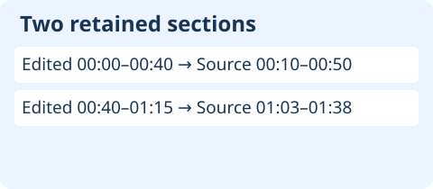
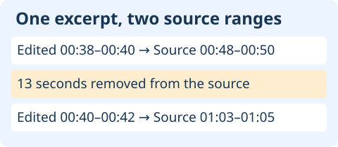

# How to Cite an Interview Transcribed From an Edited Recording

For qualitative research transcription, cite the timestamp on the recording your reader or reviewer is meant to consult. Keep the edited recording ID and its time range in your working notes. If you cite the original, map the excerpt through the edit record and replay the mapped range against that original before using it.

[Download the replay worksheet](/data/qualitative-edited-recording-timestamps-worksheet.md)

## Which timestamp belongs in the citation?

This is a manual worksheet for cuts at unchanged playback speed. InstaScript provides timestamped English transcripts for browser-decodable local audio or video up to 100 MB. Local files are processed in the browser. The tool does not map edits between recording versions.

## What changes after a cut?

In this fictional exercise, EDIT-V2 retains two sections of SOURCE-V1. Edited time 00:00–00:40 corresponds to source time 00:10–00:50. Edited time 00:40–01:15 corresponds to source time 01:03–01:38. The first section starts 10 seconds later in the source. The second starts 23 seconds later.

Try mapping edited time 00:44–00:47. Add 23 seconds to both ends to get source time 01:07–01:10. Adding 10 seconds would point to 00:54–00:57, inside the removed source interval. The transcription could be word-for-word accurate and the citation would still send a reviewer to the wrong place.

## What if the excerpt crosses the join?

For edited time 00:38–00:42, map the part before the join to source 00:48–00:50 and the part after it to source 01:03–01:05. There are 13 seconds between these replay ranges. A single citation from 00:48 to 01:05 would include material absent from the edited excerpt.

Replay the two pieces separately, then inspect the intervening source material if your study protocol permits access. Decide whether to quote each piece separately, mark an omission under your quotation convention, or leave the excerpt out. If your team cannot establish the edit map or access the source, record the edited version and mark the source time as unresolved.

## How do I check the worksheet?

Record both file IDs, the excerpt interval, each retained section, the source replay ranges and the decision to cite or hold. Treat section ends as exclusive. An excerpt ending at the join can stay in the first section, while an excerpt starting there belongs to the second.

The included Node exercise checks both offsets, both sides of the join, a crossing range, invalid bounds and the misleading global offset. It checks fictional arithmetic only. No audio or participant records are supplied. For a recording with speed changes, reordered clips or an undocumented edit, establish a verified mapping before using a source timestamp.

## Related resources

- [Qualitative research transcription guide](/qualitative-research-transcription)
- [Source locators](/qualitative-source-locators)
- [Privacy](/privacy)
- [Download the Node exercise](/data/qualitative-edited-recording-timestamps-reproduce.cjs)
