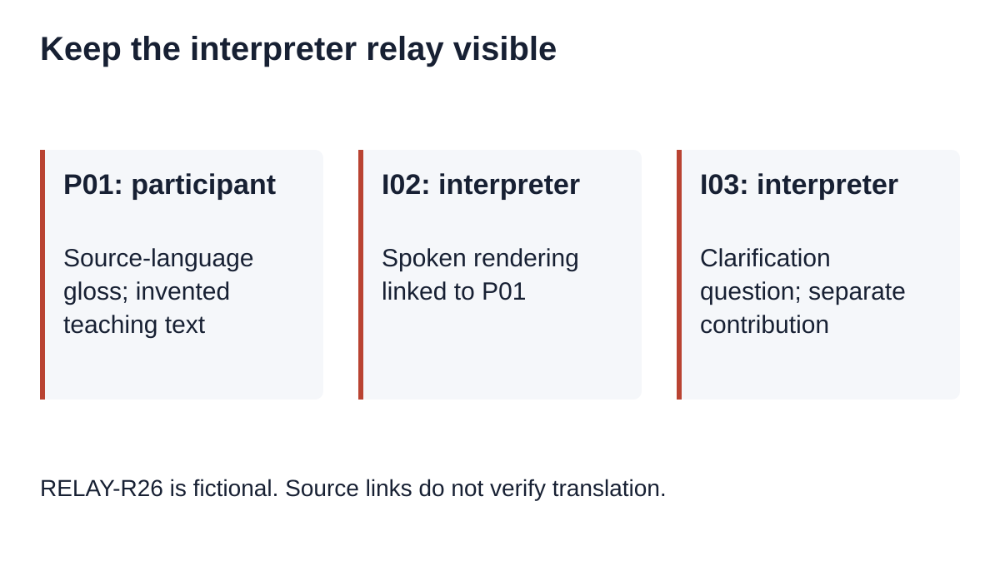
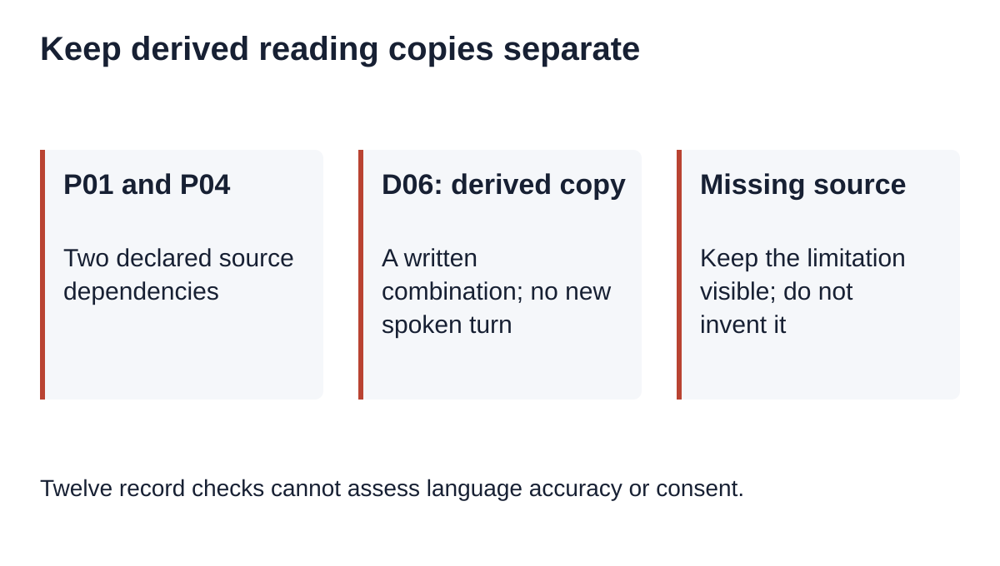

# Interpreter-Mediated Interview Transcripts: Keep the Relay Visible

Canonical: <https://instascript.app/qualitative-interpreter-turns>

Keep the participant's source turn, the interpreter's spoken rendering and any later written translation distinguishable. Record who spoke each turn and which source turn a rendering refers to. If the participant's words are not transcribed, mark that limitation explicitly; the interpreter's English words alone do not establish a verbatim participant quotation.

[Download the relay worksheet (CSV)](/data/qualitative-interpreter-turns-worksheet.csv)

## Which words does the reader actually have?

In qualitative research transcription, an interpreted interview can contain several contributions to one answer. A participant speaks, an interpreter renders that contribution, and a researcher may ask a follow-up. An interpreter can also ask for clarification or add an explanation. A transcript that labels every English sentence Participant conceals those different contributions. A project may deliberately prepare a translated reading copy, but its conventions should explain that representation and retain usable source references.

[Bailey's discussion of transcription](https://academic.oup.com/fampra/article/25/2/127/497632) explicitly raises decisions about representing interpreter-mediated talk. The [Lancaster repository abstract for Chiumento and colleagues](https://eprints.lancs.ac.uk/id/eprint/87953/) identifies interpreter roles, cross-language mediation and quality assessment as methodological considerations. Those sources establish the broader issue. The practice below is our own recordkeeping exercise, not their protocol or a validated translation assessment.

## Our fictional relay: one answer, three contributions

RELAY-R26 is entirely invented. There is no interview, recording, participant, interpreter or listening review. Every displayed sentence is English teaching text. The source-language descriptions are authored glosses standing in for another language, not actual bilingual data or verified translations.

Card P01 is a participant source turn in document R26/V1. Its invented source gloss is “I use the north gate on weekdays.” Card I02 is spoken by the interpreter, classified as a rendering of P01. Its invented English text is “She uses the north gate on weekdays.” Keep both records. The rendering refers to the participant's account, while its actual speaker remains the interpreter.

Card I03 is also spoken by the interpreter, but it is a clarification question: “Do you mean every weekday?” It is not another rendering of P01. Card P04 is the participant's next source turn, with the invented gloss “Only when the workshop is open.” Card I05 renders P04 as “Only when the workshop is open.” Identical English teaching text in two cards does not collapse their different source roles.

Create two separate fields: actual speaker role and contribution type. Then add an explicit source-turn reference for a rendering. That lets a reader distinguish I02 from I03 without assigning the clarification to the participant. The record does not claim that either English rendering is accurate. It preserves the question that a suitably qualified reviewer would need to assess against permitted source material.

## Our combined rendering and missing-source counterexamples

Suppose a working reading copy combines the two participant contributions into “She uses the north gate on weekdays when the workshop is open.” Create a new derived record D06 that names both P01 and P04 as dependencies. Keep I02, I03 and I05 in the source-turn inventory. D06 is an authored reading-copy rendering, not an additional spoken turn. Putting it between the original turn numbers would invent a contribution to the conversation.

Now remove P04 from the inventory while leaving D06's two references intact. Our checker refuses that link because a named dependency cannot be resolved. It does not rewrite the combined sentence, choose P01 alone or infer the missing condition. Conversely, a participant source turn with no rendering can remain present with its rendering status pending. Missing translation is a recorded limitation, not an empty answer or evidence that the participant said nothing.

Try a second failure: link D06 to I03, the interpreter's clarification. The checker rejects it as the wrong source type for this exercise's participant-rendering relationship. A different project could need a translation of an interpreter question; it would name that different relationship explicitly. This limited fixture does not supply a universal transcript schema.

Try changing the requested document version from V1 to V2. A familiar P01 identifier cannot silently satisfy the new request. Our example has no version migration, so the old record is refused. Duplicate turn identifiers are also refused before resolving any links. These checks protect the declared relationship inside this small dataset; they cannot establish that a real source was transcribed faithfully.

## Reproduce the exercise and use the blank worksheet

Download the [standalone Node exercise](/data/qualitative-interpreter-turns-reproduce.cjs) and compare its output with the [saved executed result](/data/qualitative-interpreter-turns-example.json). It uses embedded fictional records, makes no network request and reads no media or private transcript. Its twelve assertions cover single and combined dependencies, missing sources, role/type mismatches, duplicates, version mismatch and the difference between an unresolved rendering and a missing source.

The worksheet asks for document/version, turn reference, actual speaker role, contribution type, language representation, source-turn dependencies and review state. Use a separate row for a later written translation or reading-copy combination. Explain whether the recipient has original-language text, a gloss, an in-room rendering or a later translation. Keep the project's conventions alongside the worksheet so that unfamiliar abbreviations are interpretable.

For a real handoff, retain only references appropriate for the recipient's access. Keep identity keys and restricted recording locations in approved project storage. Record a reviewer's actual work only after it occurs. A complete worksheet is neither evidence of consent nor proof of language competence, listening, translation quality or permission to publish. Where source material is unavailable, state exactly what cannot be checked.

## What can InstaScript contribute?

This page is a manual research companion, not a multilingual interview tool. The shared [transcription tool](/) uses English-only browser speech recognition for browser-decodable local media up to 100 MB. First use loads model resources. It does not identify speakers, separate languages, align an interpreter's rendering with participant turns or validate translations. Mixed-language interviews require an appropriate project workflow beyond that recognition boundary.

Local files and subtitle edits stay in the browser. Instagram URL lookup involves servers and possible fallback services; YouTube tools read existing caption tracks. The [Subtitle Translator](/subtitle-translator) is a manual editor for supplied SRT/VTT text, with SRT export. It does not perform automatic translation. Read the [privacy explanation](/privacy) before choosing an input route.

Use the [translated-quote revision worksheet](/qualitative-translation-review) when a later source correction affects a translation decision. Use the [speaker-review guide](/qualitative-review-purposes) for unresolved attribution. Here the specific task is preserving the interpreter relay and distinguishing a derived reading copy from actual interview turns.

## Questions before sharing

**Can I label an interpreter's rendering as a participant quote?** Explain the representation and attribution according to your study's conventions. The English rendering alone does not verify the participant's exact original wording. Preserve its source relationship and any unresolved review.

**Does a source link prove translation accuracy?** No. Our exercise checks declared references and types. Accuracy requires appropriate evidence and qualified review; neither is supplied by the fictional cards.

**Must every project use this worksheet?** No. It is an optional teaching companion. Choose conventions that suit the study and document the information retained or omitted. No particular notation or software workflow is validated here.
