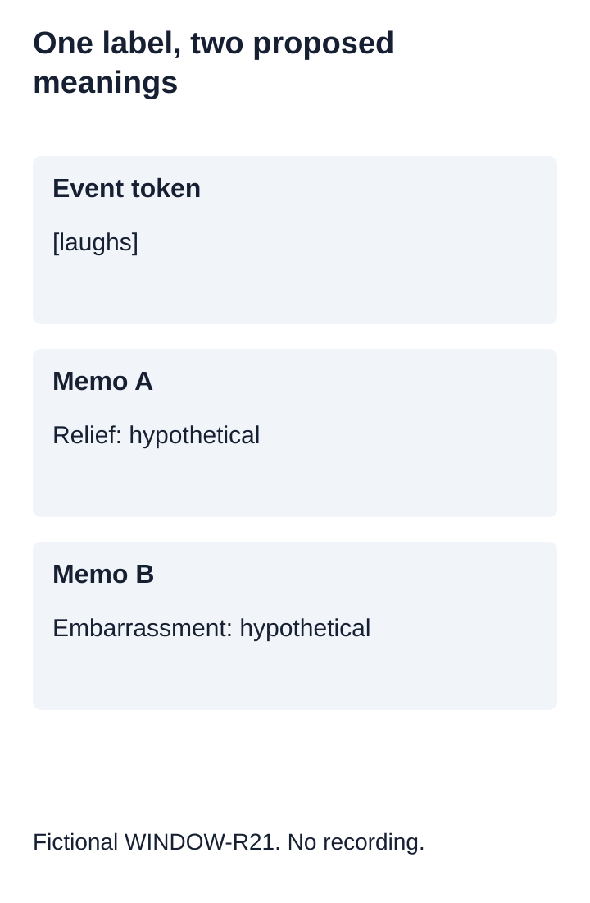
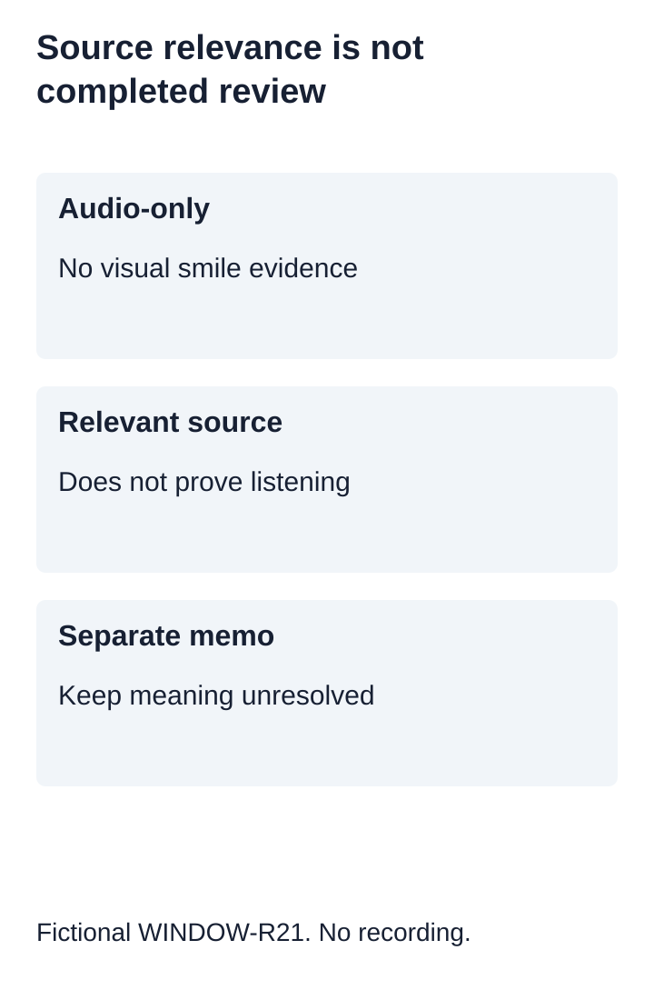

# How Should You Transcribe Laughter in Qualitative Research?

Canonical: <https://instascript.app/qualitative-nonverbal-events>

For qualitative research transcription, record a relevant nonverbal event using your study's declared convention, identify the evidence that supports the description, and keep the proposed emotional meaning in an analytical note. A label such as `[laughs]` does not, by itself, establish happiness, agreement or embarrassment. If the recording has not been reviewed for that event, keep the description pending.

This is a manual companion exercise, not a validated transcription protocol. The exercises below are entirely fictional. No person spoke these words, no event was heard, and no recording exists. They demonstrate distinctions in written records; they do not demonstrate recognition or listening accuracy.

[Download the fictional event-evidence worksheet](/data/qualitative-nonverbal-events-worksheet.md).

## Decide what the study needs before choosing a label

Nonverbal details are already an established transcription topic. [Harvard Library's guidance](https://guides.library.harvard.edu/c.php?g=796889&p=10476360) connects transcription choices with the study's methodology. [ATLAS.ti's verbatim guide](https://atlasti.com/guides/interview-analysis-guide/verbatim-transcription) discusses retaining sounds such as laughter where required. These sources do not validate the practice worksheet below.

Write down the event categories your project will attend to, the permitted sources and the notation convention before using a transcript for that purpose. A short orthographic label may be useful in one study and insufficient in another. This guide does not prescribe conversation-analysis notation, determine ethical permissions, or offer a universal level of detail.

The public [Myers and Lampropoulou abstract](https://journals.sagepub.com/doi/abs/10.1177/1468794114561346) describes examining laughter annotations against recordings and considering surrounding talk. Only the abstract was accessible in this review; the article's full analysis was not read. Our practical recommendation is an editorial inference: preserve the route from a description to its evidence rather than silently treating an annotation as a complete account of the interaction.

## Our fictional WINDOW-R21 exercise

Imagine a practice card containing the invented sentence, “I finally found the right room.” It also contains an author-supplied event label, `[laughs]`. Treat this as a written teaching fixture. It is not a transcript excerpt from a real interview.

Two fictional analysts can attach different candidate readings to the same card. One proposes relief after a difficult search. The other proposes embarrassment about arriving late. Neither reading is supplied by the label itself. The same written token is compatible with these different proposals, so copying the token into an emotion column cannot select between them. This exercise makes no claim that either reading is likely in actual interviews.

Keep three fields distinct: the event description, the origin of the information, and the interpretation. In the completed practice row, the description is the authored label `[laughs]`, the origin is “fictional teaching card”, and both interpretations remain hypothetical. A blank reviewer field stays blank. Do not invent a listening date or reviewer name to make the sheet look complete.

Now replace the token with `[laughs nervously]`. The new wording introduces a characterization that the original card did not establish. It may be a candidate analytical description, but the editor cannot promote it to an observation simply by placing it between brackets. Brackets identify a convention; they do not authenticate the statement inside them.

Next add the invented sentence, “I felt embarrassed then.” This is a separate authored statement in our practice, not a finding about a participant. In a real project, a participant's account could provide another kind of evidence with its own source and context. It should remain distinguishable from the transcriber's description of a sound. Do not silently replace `[laughs]` with `[embarrassed]` and erase that distinction.

## Our source-modality counterexample

The second practice card says an editor has an audio-only source. A proposed annotation reads `[smiles]`. Audio alone does not supply a visible facial expression. The practice answer is to request an appropriate permitted visual or observational source, or leave the visual claim unsupported. It is not to manufacture a sound that would prove a smile.

Change the description to `[laughs]`. Audio is a potentially relevant source for that sound, but merely having an audio file does not establish that the event occurred. The source might be inaudible, unreviewed or insufficient. The worksheet therefore keeps source modality and actual review result in separate columns. “Could be checked here” and “was checked here” are different statements.

For a third card, a field note describes a gesture while the audio contains only words. Keep the field note's provenance visible if the project permits its use. Do not insert its content into the transcript as though it were spoken wording. A reader should be able to tell which record supports which part of the description without seeing a private identity key.

## Our blank worksheet and handoff

The [event-evidence worksheet](/data/qualitative-nonverbal-events-worksheet.md) separates the document version, passage locator, proposed event, source modality, evidence origin, actual review result, unresolved question and analytical memo. It includes one completed fictional row and blank rows for practice. The example's source locator identifies only an invented card; it cannot locate a recording.

Work through a row in this order. First name the proposed description. Then ask what source could support it. Next record only the review that actually happened. Finally write the interpretation as a proposal with its rationale and limits. If more than one interpretation remains plausible, preserve the alternatives instead of forcing a single emotion label.

At handoff, explain which decisions remain open. For the first practice card, an accurate statement is: the author supplied a laughter token; emotional meaning is unresolved. “The speaker was happy” would claim more than the exercise supplies. “The speaker was not happy” would overreach in the opposite direction.

The [standalone Node exercise](/data/qualitative-nonverbal-events-reproduce.cjs) reproduces three narrow counterexamples: the same token retains two different candidate interpretations; an audio-only source cannot supply visual evidence; and a source's potential relevance does not establish that review occurred. It also demonstrates that an unmarked transcript can be produced under either an omit-events convention or an include-events convention with no listed event. An empty annotation list alone therefore cannot identify which history produced it. This is a logical illustration, not a measurement of omitted events in a real corpus.

Run the script with Node and compare its [saved twelve-check output](/data/qualitative-nonverbal-events-example.json). The script runs without network requests, recordings or private research text. Its checks test authored examples and declared policy boundaries. Passing them cannot authenticate a reviewer, classify a sound, determine emotion, establish a method's suitability or certify a real transcript.

## Tool boundaries and related work

InstaScript supplies an editable English speech draft from browser-decodable local files up to 100 MB. It does not verify nonverbal events, infer emotion, certify speaker identity or provide a cloud review history. Local file processing and subtitle editing stay in the browser; public Instagram URL fetching involves servers and possible fallback services. YouTube tools retrieve existing captions. See the [privacy explanation](https://instascript.app/privacy).

Use the existing [review-purpose exercise](https://instascript.app/qualitative-review-purposes) for independent wording and speaker decisions, and the [review-scope guide](https://instascript.app/qualitative-review-scope) for unchecked intervals. This guide addresses the evidence source and interpretation of nonverbal-event descriptions. It does not replace wording, speaker-attribution or interval-coverage review.

## Questions answered directly

**Does a laughter label prove happiness?** No. A written event label alone does not establish that interpretation; inspect the appropriate evidence and context for your study.

**Can an audio-only transcript establish that someone smiled?** Audio alone does not provide visual evidence of a smile. Preserve any separate visual or observational source and its limits.

**Does no laughter label prove that nobody laughed?** No. The absence could reflect the convention, an omission, an unreviewed event or a source with no such event. The practice script does not determine which occurred in a real interview.

**Are these tested product features?** No. This is a fictional record-keeping exercise. It adds no automatic event detection or emotion analysis to InstaScript.
