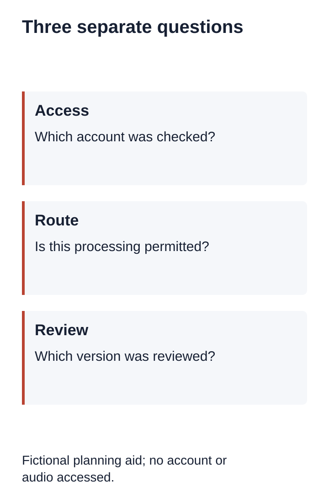
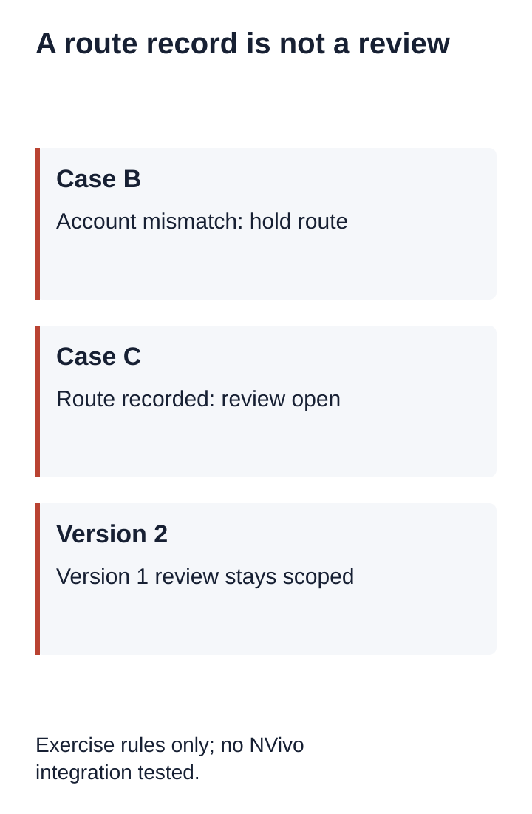

# Can NVivo Do Transcription? Check the Route Before Coding

Yes. NVivo Transcription is an automated cloud service that can work with NVivo. For qualitative research transcription, distinguish access to the analysis application, access to transcription, and a reviewed transcript ready for your study. One does not establish the other two. Check your assigned account and current product documentation before sending a recording.

[Download the route worksheet](/data/qualitative-nvivo-transcription-route-worksheet.md)

## What the official documentation establishes

Lumivero's NVivo 15 Windows guide describes sending media for cloud transcription and receiving transcripts embedded with the media. Its account guide describes subscriptions or credits and a case where university NVivo access and a personal transcription subscription belong to different accounts. These are documented capabilities and account arrangements, not tests of your installation or evidence that your institution includes transcription.

This guide does not quote prices, recommend a purchase or assess recognition quality. Check the documentation for your platform and version. An interface-language setting is not evidence that a recording language is supported.

## Fictional exercise: three questions, three records

Everything in this exercise is invented. There is no university, participant, account, recording or NVivo project behind these examples. The route record is an authored planning aid, not an entitlement checker or an NVivo file format. The downloadable script evaluates only the stated exercise rules.

Imagine a training team called LANTERN. It wants to code an English interview later. Its planning sheet contains three independent questions: does the selected service account have confirmed transcription access; has this specific recording been cleared for that processing route under the team's own study arrangements; and has the resulting transcript been reviewed for its intended analysis? A desktop application opening successfully answers none of these questions by itself.

Case A has confirmed transcription access under account TRAIN-A. The team has not recorded a decision about sending the recording to that service. Our worksheet returns HOLD ROUTE. It does not say that the vendor is unsafe or that the study prohibits cloud processing. It says the team's own route decision is missing. Buying more minutes would not complete that missing record.

Case B records a permitted route but lists account TRAIN-B in the application while its confirmed transcription access belongs to TRAIN-A. The worksheet again returns HOLD ROUTE. The exercise requires a match between the selected account and the account whose access was checked. It does not attempt a login, inspect a real license or repair a subscription. The next action is to verify the intended account through the institution or vendor's normal process.

Case C matches TRAIN-A and records permission for the chosen route. The worksheet returns ROUTE RECORDED, REVIEW OPEN because no transcript review is recorded. This is deliberately different from READY FOR CODING. A service returning text would not by itself establish that speaker labels, unresolved terms or required transcription detail have been checked.

Case D adds a review entry for transcript LANTERN-T1, version 1. Our exercise can now return REVIEW RECORDED. It still does not certify accuracy or methodological fitness. The team must read the actual review scope and unresolved items. The status is evidence that the planning fields are filled, not evidence that a machine has validated an interview.

## Try a counterexample before using the worksheet

Keep Case D unchanged except for the transcript version: the working file is now version 2, while the review still names version 1. The exercise returns REVIEW OPEN. A completed review of one file cannot serve as an unqualified review record for another. This rule is part of our authored exercise; it is not a claim about NVivo automatically invalidating anything.

Next remove the confirmed-access account entirely. The status returns HOLD ROUTE rather than assuming access from the application's presence. Finally change the permission field to unknown. The result remains HOLD ROUTE even if every other field is filled. Unknown is a request to resolve the decision, not a prohibition invented by the worksheet.

The exercise intentionally stops before upload. Reproduce it with the fictional identifiers only. Do not enter credentials, real account addresses, participant names or private transcripts into the downloadable script. Six assertions check these cases; no transcription service is contacted and no recognition speed or accuracy is measured.

## Copy the planning fields

| Field | Value |
|---|---|
| Application platform and version | To verify |
| Selected service account alias | Unknown |
| Account alias with confirmed transcription access | Unknown |
| Evidence and date of access check | Not checked |
| Study decision for the chosen processing route | Unknown |
| Recording alias and version | To record privately |
| Transcript alias and working version | Unknown |
| Review scope and reviewed version | Not reviewed |
| Unresolved issues and next action | Open |

## Where InstaScript fits

InstaScript can create a browser-local English-only speech draft from browser-decodable audio or video up to 100 MB. Local files and subtitle edits stay in the browser. Its TXT and Markdown exports are documents; this guide does not demonstrate a native NVivo project, automatic coding, verified speaker identification or a tested media-linked import. Keep a permitted recording available for review and use the target application's current import instructions.

The worksheet is manual. It does not connect to NVivo, upload a file, purchase transcription or determine institutional permissions. This article's cloud description refers to NVivo Transcription, not to InstaScript's local-file workflow.

## Sources and related work

- [Lumivero: NVivo Transcription, NVivo 15 Windows](https://community.lumivero.com/s/article/NV15Win-Content-files-nvivo-transcription)
- [Lumivero: Transcription and myLumivero](https://community.lumivero.com/s/article/NVT-Content-transcription-account)
- [Qualitative research transcription](/qualitative-research-transcription)
- [Review scope](/qualitative-review-scope)
- [Privacy](/privacy)

Official capability and account descriptions were checked on November 7, 2026. The fictional exercise is our own planning model. No vendor endorsement, native application test or human transcript verification is claimed.

- [Download the fictional exercise](/data/qualitative-nvivo-transcription-route-reproduce.cjs)
