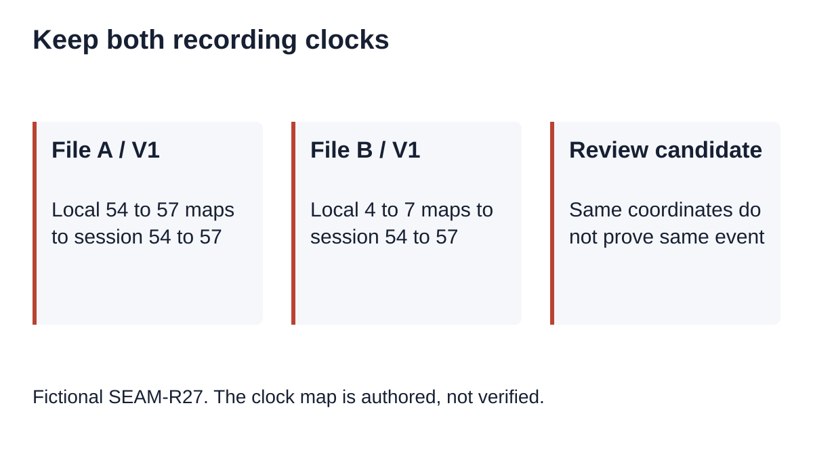
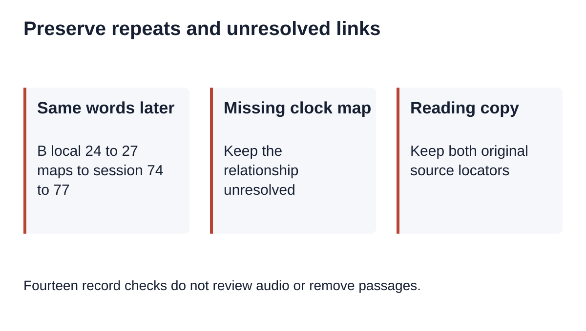

# Overlapping Interview Recordings: Keep Both File Clocks

Canonical: <https://instascript.app/qualitative-recording-overlap>

Do not remove a repeated transcript passage just because its words match. Keep each recording reference and local timestamp, establish whether the files cover the same part of the interview, and document any confirmed duplicate capture separately from the retained transcript. If the recording relationship is unknown, leave the passage unresolved rather than silently deleting it.

[Download the recording-boundary worksheet (CSV)](/data/qualitative-recording-overlap-worksheet.csv)

## What repeats: a sentence or its recording?

In qualitative research transcription, two files can contain a shared stretch of one conversation. A recorder might create overlapping chunks, or a project might retain overlapping exports. The same sentence can also be spoken twice at different moments. These situations require different decisions. Equal text alone cannot distinguish them, and a timestamp such as 00:04 identifies a position only within its named recording.

[ATLAS.ti's formatting guide](https://atlasti.com/guides/interview-analysis-guide/transcription-formatting) already discusses source references, speaker turns and timestamps. [Harvard Library's recording guide](https://guides.library.harvard.edu/c.php?g=796889&p=10476360) relates transcription choices to methodology and notes the need for manual revision of automated drafts. Our contribution is a small, inspectable boundary-reconciliation exercise, not a claim that those sources omit traceability or a rule for every research project.

## Our fictional boundary: two clocks, one declared interval

SEAM-R27 is entirely invented. There is no interview, recording, participant or listening review. The times, source relationships and sentences are authored teaching material. A declared clock map makes the arithmetic inspectable; it is not evidence that real files have been synchronized.

The exercise defines file A/V1 as session seconds 0 through 60 and file B/V1 as session seconds 50 through 100. Both are unchanged-speed segments of the same invented session S27. Their declared shared interval is session seconds 50 through 60. Local time in A equals session time. Local time in B needs an added 50 seconds. These are two separate file clocks, not two competing timestamps for one file.

Card A1 contains the invented sentence “The gate was open.” at A local seconds 54 through 57. Card B1 contains the same sentence at B local seconds 4 through 7. Under the supplied map, both intervals become session seconds 54 through 57. Their common coordinates identify a candidate for boundary review. The exercise additionally declares that A1 and B1 capture the same fictional event; the clock arithmetic alone does not prove that declaration.

Keep both source locators even if a working reading copy displays the passage once. In our fictional decision ledger, row D1 retains A1 in the reading copy and marks B1 as an alternate capture of that declared event. It does not delete B1 from the source inventory. A reviewer can still find both file-local ranges and inspect the recorded basis for the relationship. Selecting A1 here is an arbitrary teaching choice, not a recommendation that the first file is more accurate.

## Our repeated-sentence and missing-map traps

Add Card B2 with exactly the same sentence at B local seconds 24 through 27. It maps to session seconds 74 through 77, outside the declared shared interval. This is a separate authored occurrence. A text-only duplicate filter would remove B2 together with B1 and lose a deliberately distinct moment. The exercise keeps B2 without claiming anything about why a real speaker might repeat words.

Now change B1's text to “The gate is open.” while keeping its original local range. The mapped interval still coincides with A1. The checker returns a wording-conflict candidate, not a ready-to-collapse pair. One transcript could contain an error, the boundaries could be imprecise, or the source relationship could be wrong. Real review would need the permitted recordings and their context; the checker cannot select the correct verb.

Remove B's map altogether. Matching words and convenient local times must not recreate it. The relationship becomes unresolved. A file's creation time, a familiar filename or the order of files in a folder is not a verified synchronization record. Keep the two passages and state that the boundary has not been reconciled. The worksheet permits a pending decision without inventing a session timestamp.

Finally, request version V2 of B while supplying only the V1 map. The checker refuses that request. An edited or stretched replacement could invalidate a formerly useful offset. This exercise accepts only its declared unchanged-speed segments. It does not estimate drift, align waveforms, identify speakers, merge media or solve a passage that crosses an undocumented cut.

## Reproduce the decisions before using the blank ledger

Run the [standalone Node exercise](/data/qualitative-recording-overlap-reproduce.cjs) and compare the [saved executed output](/data/qualitative-recording-overlap-example.json). Fourteen assertions check both clock mappings, the shared interval, the repeated sentence at a later moment, wording conflict, missing maps, version mismatch, different sessions, invalid intervals and preservation of both original locators. The script has no network access or media input. Passing assertions establish only that these authored records follow the declared arithmetic and refusal rules.

The blank worksheet separates recording reference/version, local start/end, session reference, mapping basis, mapped range, paired passage, boundary-review state, retained reading-copy reference and actual review evidence. Write a basis only when it exists. In real work, document the permitted comparison and the actual reviewer after review occurs. A populated row is not proof that anyone listened, that two waveforms match or that the transcript is accurate.

An unresolved boundary can remain visible in a research handoff. Explain which passages might be alternate captures and why you have not made a collapse decision. Do not count a candidate relationship as confirmed duplication. If only one file is accessible, identify that access limit. Keep restricted source locations and any participant identities in approved project storage; the public exercise requires neither.

## What can InstaScript do here?

This is a manual research worksheet, not an automatic recording-merger tool. InstaScript's shared [transcription tool](/) makes English-only browser drafts from browser-decodable local media up to 100 MB. First use loads model resources; cached resources may still require initialization. It does not synchronize multiple recordings, detect duplicate captures, estimate clock drift or approve research evidence. A separate draft from each file retains that file's own timing context.

Local files, transcript edits and subtitle work stay in the browser. Instagram URL retrieval involves servers and possible fallback services. YouTube tools retrieve existing caption tracks; they do not generate missing captions. The [privacy explanation](/privacy) describes these different input routes. No research recording or private transcript was used to build this article.

For a timestamp after a cut within one recording, use the [edited-recording map](/qualitative-edited-recording-timestamps). For display rows versus counting units, use the [counting-unit exercise](/qualitative-transcript-counting-units). This page's separate task is reconciling the boundary between multiple recording clocks while retaining alternate source locators.

## Questions before combining drafts

**Can equal timestamps prove the same utterance?** No. They need a named recording and a justified relationship between clocks. Even mapped equality is only a candidate relationship without appropriate source evidence.

**Should I delete the alternate source passage?** This exercise retains both source records and documents a separate reading-copy choice. Your project's conventions govern its actual workflow; this teaching ledger does not authorize deletion or publication.

**Does the checker review audio?** No. It checks invented coordinates and record states. It provides no synchronization service, accuracy measurement or human verification.
