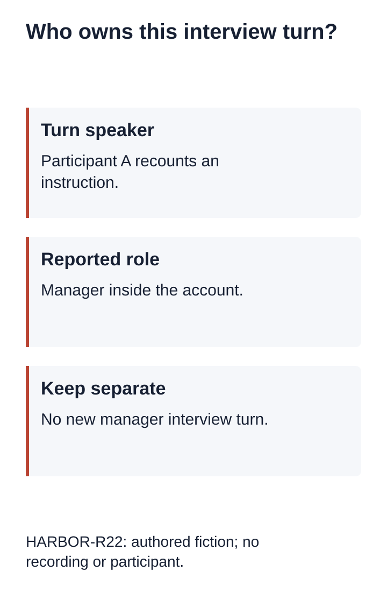
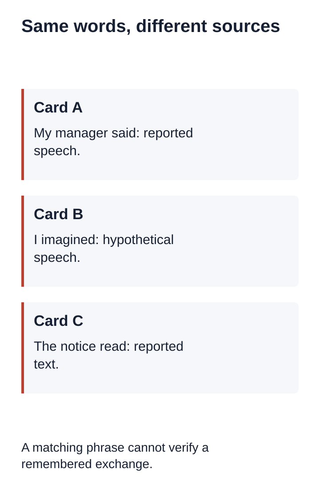

# How Do You Keep Reported Speech Separate from Interview Speakers?

Canonical: <https://instascript.app/qualitative-reported-speech>

In qualitative research transcription, keep a participant's account of someone else's words inside that participant's turn. Identify the person being reported in a separate note when needed. Quotation marks or a changed voice do not establish that the reported person spoke in the interview, and the account alone does not verify an earlier conversation.

[Download the practice worksheet](/data/qualitative-reported-speech-worksheet.md).

## Which speaker does the label identify?

A transcript turn identifies a contribution to the interview being represented. Within that contribution, a person may recount a conversation, offer an imagined reply, or quote a phrase from a notice. These different sources can contain the same words. Keep the reporting frame visible so a reader can distinguish them before making an analytical claim.

This guide offers a manual teaching exercise, not a validated notation system or a speaker-recognition feature. Follow your study's transcription convention and permitted evidence. Every example below is authored fiction: there is no recording, participant, manager or observed conversation. The labels are stipulated roles in a written exercise, not identities established through listening.

## Our fictional HARBOR-R22 case

The invented document HARBOR-R22, version V1, contains turn T04, assigned to Participant A for the exercise. Its full text is: My manager said, "Use the side entrance." I waited at the front because I did not know where that was. No manager turn or separate manager interview is supplied.

Keep T04 under Participant A. In a companion note, record the reporting frame as "My manager said" and the embedded words as "Use the side entrance." The participant's account attributes those words to a manager. The available written fixture cannot establish whether a manager actually used that wording, when an earlier conversation occurred, or how the instruction sounded.

The unsafe rearrangement removes the frame and creates a new turn: Manager: Use the side entrance. That changes the document's apparent source. A recipient could read the invented new line as a manager's contribution to the interview. Retaining identical words inside the quotation does not preserve the same evidential relationship when their surrounding attribution changes.

Compare two practice summaries. "Participant A recounts an instruction attributed to a manager" fits the authored record's structure. "The manager instructed the participant during the interview" adds an event that the fixture does not contain. Neither summary is a finding about real people. Their difference illustrates why a clean-looking speaker list can still misrepresent the source.

## Our same-words, different-source counterexample

Card A uses the reporting frame from T04: My manager said, "Use the side entrance." Card B is explicitly hypothetical: I imagined my manager saying, "Use the side entrance." Card C refers to text: The notice read, "Use the side entrance." The embedded string is identical across all three authored cards.

A search for that string finds all three cards. It does not distinguish a reported exchange from an imagined reply or a reported written notice. Preserve each card's full frame and classify only the relationship that the author supplied for this exercise. The script does not attempt to infer these categories from natural language; they are explicit input fields.

If you quote only the embedded words in an analytical memo, carry the card locator and source relationship alongside them. A reader should be able to recover whether the practice author framed the words as recollection, imagination or written text. Dropping the frame without another recoverable record creates an ambiguity that the shared string cannot resolve.

Now imagine the worksheet's reported-person field is blank. Preserve that blank or record "unspecified in this card"; do not fill it from a plausible role or a nearby name. If two participants recount similar words, retain two separately located accounts. Similarity alone does not show they witnessed the same event, independently corroborated it, or share a reported speaker.

## Our worksheet and reproducible exercise

The [worksheet](/data/qualitative-reported-speech-worksheet.md) separates document version, interview-turn speaker, full turn, reporting frame, embedded words, reported source, source relationship and permitted claim. One row is completed with HARBOR-R22; another is blank for practice. The example's source is an authored card. Reviewer and listening-date fields remain blank because no listening occurred.

Work through the completed row before shortening it. First read the full turn. Next identify who owns the turn in the fixture. Then inspect the reporting frame and record the attributed source separately. Finally write a claim that retains the relationship: an account of another person's words, an imagined statement, or an account of written text. These are descriptions of the practice cards, not general rules for interpreting every quotation.

Run the [standalone Node exercise](/data/qualitative-reported-speech-reproduce.cjs) and compare its [saved output](/data/qualitative-reported-speech-example.json). It checks explicit fictional records, preserves the outer turn label, rejects a request to promote the reported role into that turn, and shows that the three source relationships share one embedded string. It also refuses an invented interview contribution for an unspecified role.

Passing these checks cannot determine who actually spoke, authenticate remembered words, detect quotation boundaries in audio, or verify an earlier event. The script has no recordings, model, network access or research files. Its refusal is an exercise policy chosen by the author; it is not a general-purpose validator of real interview data.

## Established guidance and this exercise's contribution

[ATLAS.ti's formatting guide](https://atlasti.com/guides/interview-analysis-guide/transcription-formatting) discusses speaker labels, separate turns and line references. [Harvard Library's guidance](https://guides.library.harvard.edu/c.php?g=796889&p=10476360) connects transcription decisions with methodology and notes the need to revise automatic output. Those broad topics are established. Our contribution is the authored nested-source counterexample, completed and blank worksheet, and reproducible demonstration; neither source validates it.

Use the existing [wording and speaker review guide](/qualitative-review-purposes) when deciding which interview speaker belongs to a passage. Use the [coding evidence guide](/qualitative-coding-evidence) when selecting a passage with its necessary context. This page addresses a further source relationship within an already labelled turn. It does not replace either decision.

## What can InstaScript do here?

InstaScript can prepare an editable English speech draft from browser-decodable local media up to 100 MB. Initial use loads model resources. It does not identify speakers, detect reported speech or verify that a remembered statement occurred. This worksheet is a separate manual resource. No account history or team review system is added.

Local media processing and subtitle edits stay in the browser. Instagram URL fetching involves servers and possible fallback services; YouTube tools retrieve existing captions and successful lookups may be cached for one hour. Read the [privacy explanation](/privacy) before choosing a route for permitted material.

## Questions answered directly

**Does quoting a manager create a manager interview turn?** No. Preserve the reporting participant's turn and record the reported role separately unless separate evidence supports a different interview contribution.

**Do quotation marks verify the earlier wording?** No. They can express a transcription or editorial convention; the reported account alone does not authenticate an earlier exchange.

**Can the same phrase represent recollection, imagination and written text?** Yes, as the fictional cards demonstrate. Preserve the frame and source relationship; matching words alone cannot choose between them.
