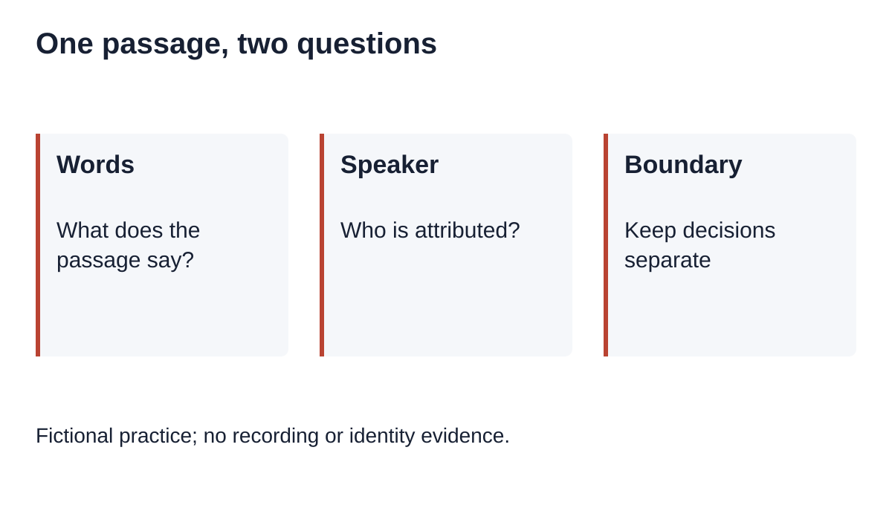
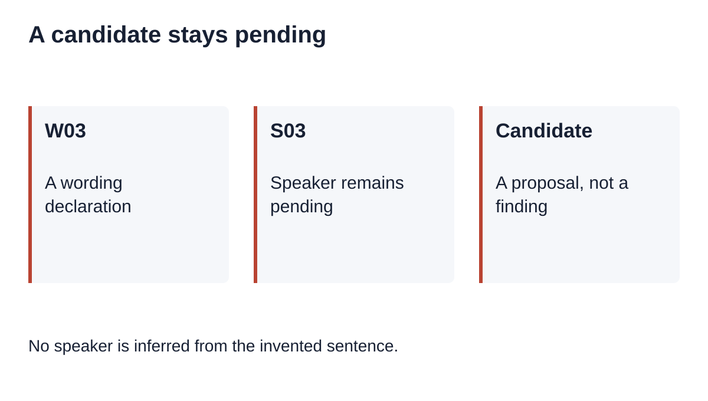
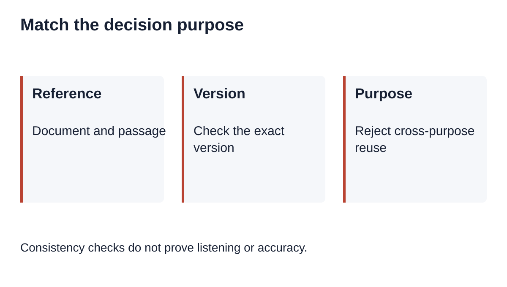

# Transcript Wording and Speaker Labels: Keep Two Review Decisions

Canonical: <https://instascript.app/qualitative-review-purposes>

For qualitative research transcription, review the words and the speaker label as separate decisions. A passage can have settled wording while its speaker remains unresolved. Record a purpose, a transcript version, a passage reference and a rationale for each decision; do not copy a wording result into a speaker-attribution field.

[Download the two-purpose worksheet](/data/qualitative-review-purposes-worksheet.md)

## What needs a separate decision?

Wording asks which words belong in a passage under the project's transcription convention. Speaker attribution asks which speaker label belongs to that passage. A label can be uncertain even when the sentence is legible. Conversely, a stable label does not settle an unclear noun. Neither result alone approves an interpretation or establishes permission to quote.

This is a manual companion exercise. InstaScript does not identify research participants, automatically assign speaker identities or keep authenticated team review records. The distinction here is a recordkeeping rule for practice, not a validated research method. Use the actual study protocol to decide what evidence and review are required.

## Our fictional two-purpose case

Fictional practice; no recording or identity evidence.

The invented working document is PURPOSE-R10, version V1, passage P03. Its text is: We moved the meeting outside. Its draft speaker field is unresolved. There is no recording, participant or listening session. The exercise supplies no true speaker and does not ask you to guess one from the sentence.

Create decision W03 for wording and decision S03 for speaker attribution. Both point to P03 and V1, but they have different purposes and independent states. The demonstration starts with both pending. It then applies an explicitly fictional wording decision while leaving S03 pending. That state is the worked example's intended result, not evidence that the sentence was heard correctly.

| Fictional event | Wording W03 | Speaker S03 | Supported administrative statement |
|---|---|---|---|
| Create two tasks | pending | pending | Both questions remain open |
| Declare a wording decision in the exercise | decided | pending | A wording record exists; no speaker decision |
| Add a speaker candidate | decided | pending | A proposal exists, not a decided attribution |
| Attempt to reuse W03 for speaker attribution | decided; unchanged | pending; unchanged | Request refused; neither record is rewritten |

The deliberately unsafe alternative uses one flag called reviewed for the entire passage. Once that flag becomes true, a recipient cannot tell whether somebody inspected words, a speaker label, timing, or all three. Our example replaces that flag with two named records. It does not claim that adding fields proves the records are truthful.

## Our reproducible purpose check

No speaker is inferred from the invented sentence.

The [companion Node script](/data/qualitative-review-purposes-reproduce.cjs) runs on embedded fictional records with no network, audio or private text. Run it with Node and compare the [example output](/data/qualitative-review-purposes-example.json). It tests a narrow invariant: a decision must match the requested purpose, version and passage. Applying a wording decision to a speaker task throws a purpose-mismatch error. Applying a speaker decision to wording is refused in the other direction as well.

A pending record cannot satisfy a request for a decided result. A decided record requires a nonempty rationale, but a rationale is only a declared explanation. Someone could invent an explanation that passes a form check. This script therefore cannot authenticate reviewers, prove listening, verify identity or assess whether a source is sufficient for a real research decision.

Try the candidate counterexample. Add the fictional candidate Speaker B to S03 without changing its pending state. The checker still refuses a decided-speaker request. The candidate may be stored for later consideration, but the code does not promote it to a speaker label. No demographic, role or identity inference is made from the wording.

Try a changed-reference counterexample. Request PURPOSE-R10/V2 or passage P04 using the V1/P03 record. Both requests fail. A real project may have an explicit mapping between versions, but this tiny exercise has none. When a source changes, document the mapping and assess the affected decisions rather than assuming that the passage name is permanently stable.

## Our worksheet and handoff

Consistency checks do not prove listening or accuracy.

Start with a project-safe document reference and version. Give each passage a locator that the recipient can actually use. Add separate rows for wording and speaker attribution, with independent status, candidate, permitted next action and rationale fields. Record who performed a real check and when only after that work has occurred. Keep restricted recording locations and identity keys in approved storage outside a broadly shared worksheet.

For an unresolved label, write what remains unresolved and what may be inspected next. Do not infer the speaker from a job title, a plausible opinion or the order of names in a participant list. If a real project has a permitted recording or corroborating record, document the actual basis and its limits. This exercise provides no such material and consequently leaves speaker attribution pending.

At handoff, ask the recipient to read both purpose rows. A concise statement might say: the exercise contains a declared wording decision for V1/P03; speaker attribution remains pending. Do not shorten that to transcript verified. If the recipient needs review coverage, attach a separate interval record; if a wording dispute needs another owner, attach a decision handoff. Those tasks answer different questions.

## Sources and tool boundaries

[ATLAS.ti's formatting guide](https://atlasti.com/guides/interview-analysis-guide/transcription-formatting) discusses speaker labels and turn divisions as transcript structure. [Harvard Library's recording guidance](https://guides.library.harvard.edu/c.php?g=796889&p=10476360) relates transcription choices to methodology and notes manual revision of automatic output. Neither source validates our fictional checker. Speaker labels and transcript review are established topics; the contribution here is the explicit purpose-mismatch counterexample and practice worksheet.

The shared [English transcription tool](/) accepts browser-decodable local media up to 100 MB. Local file speech processing stays in the browser and first use loads model resources. Instagram URL fetching involves a server and possible fallback service. YouTube tools retrieve existing captions. No workflow here adds speaker recognition, participant identity verification or cloud review history. Read the [privacy explanation](/privacy).

Use the [review-scope guide](/qualitative-review-scope) to list unchecked intervals and the [reviewer-handoff guide](/qualitative-reviewer-handoff) to carry an unresolved wording question between reviewers. This practice separates decision purposes within a passage; it does not replace either workflow.
