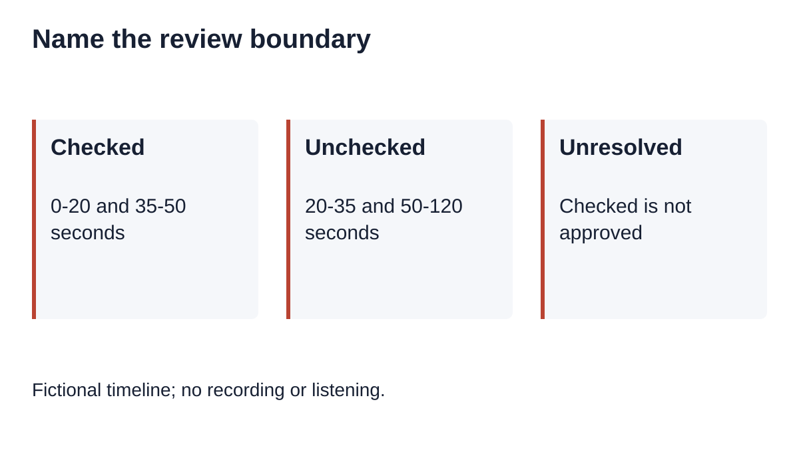
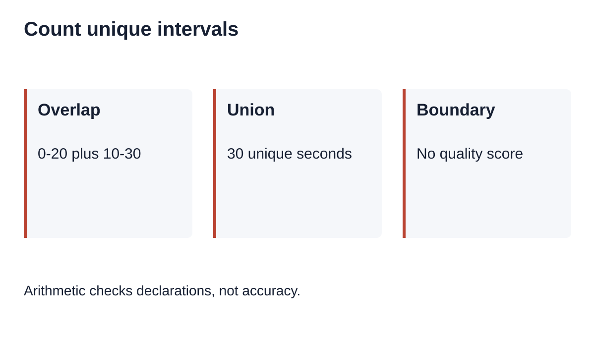
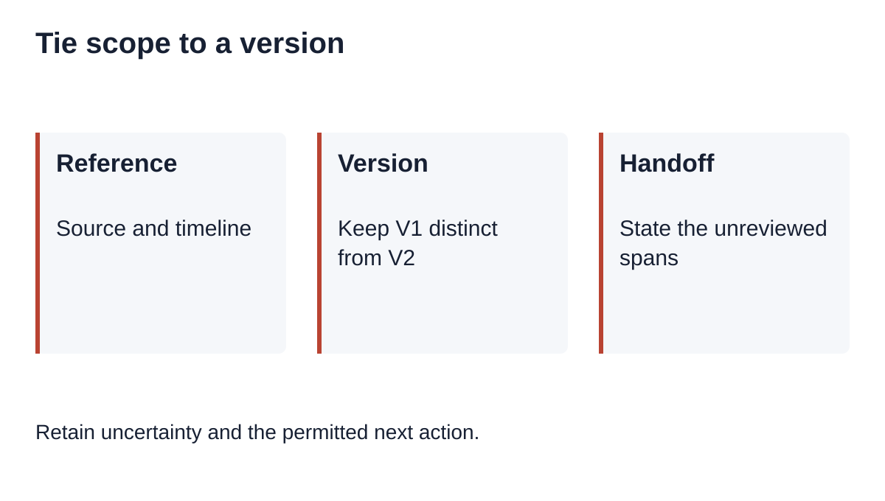

# Partial Transcript Review: Name the Unchecked Intervals

Canonical: <https://instascript.app/qualitative-review-scope>

For qualitative research transcription, record the exact intervals checked against the recording, the transcript version and the review purpose. List the remaining intervals as unreviewed. A checked excerpt does not establish that the whole recording was verified, and an unresolved word inside a checked interval must stay unresolved.

[Download the review-scope worksheet](/data/qualitative-review-scope-worksheet.md)

## What this record can establish

A review-scope record answers where a check took place. A correction ledger answers what changed. Keep these records linked but separate: a reviewer can listen to a passage without resolving every word, and can correct one word without reviewing the surrounding interview. This guide offers a manual practice worksheet, not an automatic listening audit or a recommendation to replace a study's required review procedure with sampling.

The worked example below is entirely fictional. Its times describe an invented recording of 120 seconds; no recording exists and no person listened to it. The script checks interval bookkeeping only. It cannot establish accuracy, methodological adequacy, consent, speaker identity or the trustworthiness of a real review claim.

## Our fictional scope map

Fictional timeline; no recording or listening.

Imagine a working transcript called SCOPE-R9, version V1. The exercise declares a timeline from 0 through 120 seconds. Use half-open intervals: the start belongs to an interval and its end belongs to the next interval. Thus [0,20) and [20,35) meet without overlapping or leaving a gap. The recording endpoint is 120; it does not create an extra second of content.

| Interval in seconds | Declared action | What remains outside that claim |
|---|---|---|
| [0,20) | Fictional check for wording | One candidate word remains unresolved |
| [20,35) | Not reviewed | No wording claim |
| [35,50) | Fictional check for wording | Speaker identity not assessed |
| [50,120) | Not reviewed | No wording claim |

The two checked intervals total 35 seconds. The complement totals 85 seconds. These are exact arithmetic results for this invented timeline, not measured listening time, a quality percentage or evidence that 35 seconds would be an adequate sample. A reviewer may replay the same interval repeatedly; replay duration and unique timeline coverage answer different questions.

A tempting but invalid summary is: recording reviewed, transcript approved. A narrower exercise summary is: V1 has declared wording checks at [0,20) and [35,50); the remainder is unreviewed; one word remains unresolved. The second sentence preserves both the spatial boundary of the review and the outstanding decision. It still remains a fictional declaration rather than evidence of listening.

## Our reproducible refusal checks

Arithmetic checks declarations, not accuracy.

Download the [interval exercise script](/data/qualitative-review-scope-reproduce.cjs) and run it locally with Node. The [example output](/data/qualitative-review-scope-example.json) contains the derived unchecked intervals and the actual number of assertions. No package installation, network request, audio or transcript is needed. Read the code before applying any adapted rule to project records.

The script sorts valid intervals, merges overlapping or touching checked spans, then derives the complement inside the declared duration. It refuses negative starts, zero-length spans, reversed intervals, non-finite values and endpoints beyond the recording. A changed version fails a version match. These refusals catch bookkeeping errors; they do not authenticate declarations.

Try the overlap counterexample: [0,20) plus [10,30) covers 30 unique seconds, not 40. Try the adjacent case: [0,20) plus [20,35) leaves no unchecked interval between them. An empty list means the full [0,120) remains unreviewed. A full [0,120) declaration has an empty complement, but even that mathematical result does not prove that anybody listened or approved the wording.

Now change V1 to V2 after inserting a passage or replacing the source recording. Do not silently carry forward the old scope map. Establish that the source and timeline are still the same, identify affected text and record the decision about which checks require repetition. The fixture deliberately rejects a mismatched version; it cannot determine whether a real edit invalidates an earlier check.

## Our worksheet and handoff

Retain uncertainty and the permitted next action.

Use the downloadable blank worksheet to record a project-safe source reference, transcript version, duration provenance, time convention, review purpose and actual checked intervals. Add the reviewer reference and review date only when a review actually occurs. Keep sensitive recording locations in approved restricted storage. Do not put participant names or private file paths into a broadly shared worksheet.

List unreviewed intervals explicitly. Give a reason when useful, such as pending access or outside the present task, without treating that reason as approval. Keep unresolved wording issues in a separate decision list with a locator and permitted next action. A recipient should be able to distinguish not listened to, listened to but unresolved, and a documented wording decision.

Before handoff, compare the checked union and its complement against the declared timeline. Ask whether any interval is missing, double-counted or tied to an old version. Then write one sentence stating exactly what the record supports. If the duration or recording mapping is unknown, retain that limitation and do not manufacture a complete interval map. A mathematically complete map is still not a quality certificate.

## Sources and next steps

[Harvard Library's recording and transcription guide](https://guides.library.harvard.edu/c.php?g=796889&p=10476360) connects transcription decisions to study methodology and notes the need for manual revision of automatic output. [ATLAS.ti's annotation guide](https://atlasti.com/guides/interview-analysis-guide/annotated-interview-transcripts) discusses adding observations and interpretation to interview text. These general principles do not validate the invented interval exercise or prescribe its sampling policy.

For an English draft, the [shared transcription tool](/) processes browser-decodable local media up to 100 MB. English speech recognition runs in the browser; first use loads language-check and recognition resources. Recognition can fail or leave uncertain wording. Local file processing does not upload content; Instagram URL fetching involves a server and possible fallback service. This guide stores no review history and does not add an automated verification feature. See the [privacy explanation](/privacy).

Use the [reviewer handoff exercise](/qualitative-reviewer-handoff) for an unresolved wording decision, and the [source locator exercise](/qualitative-source-locators) when a working copy needs a separately protected recording reference. This page concerns the boundary of review, rather than resolving words or approving an entire research transcript.
