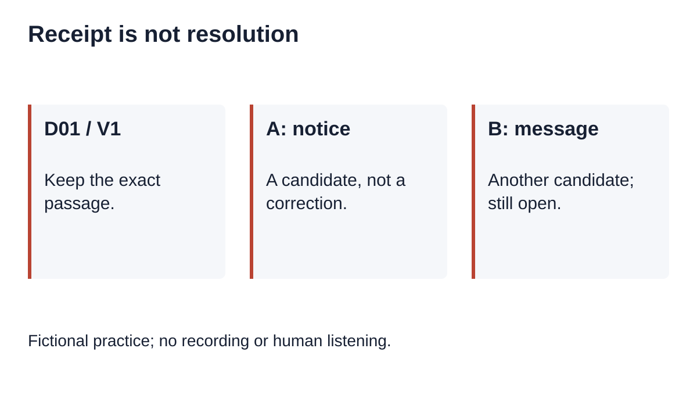
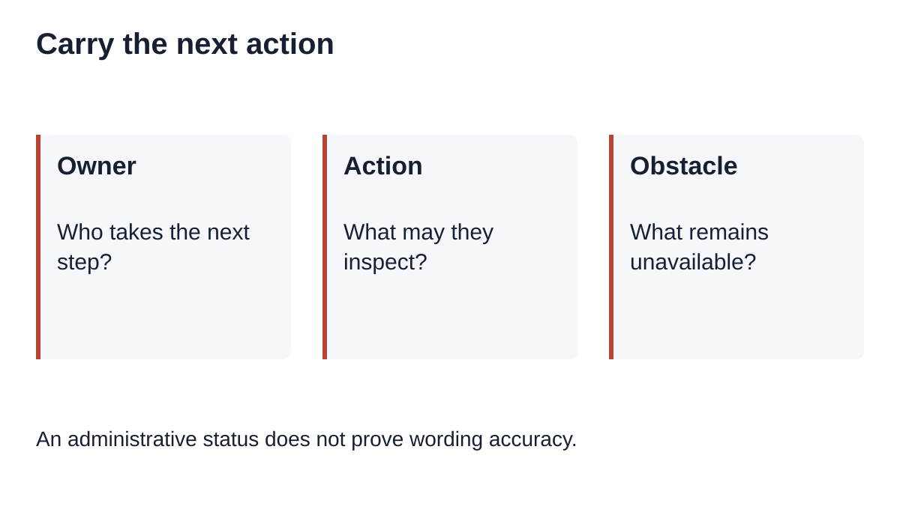
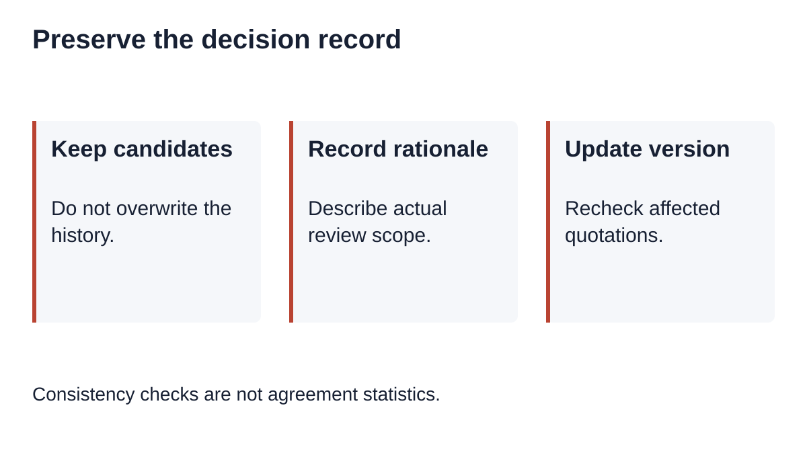

# Two Transcript Reviewers: Hand Off the Unresolved Decision

Canonical: <https://instascript.app/qualitative-reviewer-handoff>

Hand off an unresolved transcription decision with the exact transcript version and passage, each proposed reading, the work actually done, and a named next action. Keep the issue open until the agreed review step is completed. A second reviewer acknowledging receipt does not establish that a word was heard correctly or that both reviewers agree.

[Download the decision-handoff worksheet](/data/qualitative-reviewer-handoff-worksheet.md)

## What should the second reviewer receive?

Send a permitted working copy and a separate decision ledger through your approved project process. Give the recipient enough context to find the disputed passage without distributing restricted identifiers. Distinguish a request to inspect wording from a request to interpret a passage. A transcript correction, a participant clarification and a coding decision can require different records.

The [ATLAS.ti annotation guide](https://atlasti.com/guides/interview-analysis-guide/annotated-interview-transcripts) discusses adding observations and interpretive notes to interview text. [Harvard Library's transcription guidance](https://guides.library.harvard.edu/c.php?g=796889&p=10476360) connects transcription choices to the research method and calls for revision of automated text. The exercise below offers a small workflow for carrying a pending wording decision between people. It is not a claim that those sources omit collaboration or review.

## Our fictional case: receipt leaves the word unresolved

Fictional practice; no recording or human listening.

Everything in this case is invented for practice. There is no participant, recording, human listening session or measured agreement. The working text is HANDOFF-R8, version V1, cue C02: “We used the [unclear] board.” The bracketed marker was authored for this exercise. Reviewer A proposes “notice”; reviewer B proposes “message.” Neither candidate is inserted into the working text.

The issue ID is D01. Its question is “Which word belongs before board?” Its scope is wording, not thematic interpretation. Its current state is open. Its next owner is reviewer B, whose next action is to inspect an authorized source under the project's transcription convention. The exercise deliberately has no source to inspect, so the honest outcome remains unresolved. A real team must record the actual work it performs rather than copying an invented completion entry.

| Event | State afterwards | What it establishes |
| --- | --- | --- |
| A records a candidate | open | A proposal exists |
| B acknowledges D01 | open | The handoff was received |
| B offers a different candidate | open | Another proposal exists |
| Review source is unavailable | open | A documented obstacle remains |
| Both names appear in the ledger | open | Two names alone do not establish agreement |

Keep both candidates visible even when one seems more plausible in context. The exercise provides no basis for choosing either. Copying the latest candidate into the transcript would erase the distinction between an interpretation and a supported correction. If the project permits analysis of unaffected passages, identify the pending passage explicitly; this ledger does not decide whether the study may proceed.

## Our reproducible check: reject administrative closure

An administrative status does not prove wording accuracy.

Run the [standalone Node exercise](/data/qualitative-reviewer-handoff-reproduce.cjs) and compare its [actual output](/data/qualitative-reviewer-handoff-example.json). It uses embedded fictional text and makes no network requests.

The companion Node exercise uses only embedded fictional text. It checks that an acknowledgment leaves D01 open, that both candidates survive a handoff, and that a changed transcript version requires renewed passage review. It rejects closure with no rationale or no review record, duplicate issue identifiers, a missing next owner and an altered passage. It also constructs a false closure based only on an acknowledgment and confirms that the example's rules reject it.

These checks test the authored ledger rules, not the truth of a transcript. They do not establish reviewer identity, listening accuracy, agreement statistics, research validity or access control. Someone can invent a rationale that satisfies a form. A real project still needs an appropriate review process and a trustworthy record of what occurred. Do not describe successful validation as human verification.

The fixture keeps the original working text unchanged. Its comparison is deliberately exact: HANDOFF-R8/V2 is not accepted as V1, and a changed C02 needs a refreshed reference. Exact equality is useful for this tiny example but is not a universal passage locator. Projects that resegment cues should retain an explicit mapping rather than assuming cue numbers remain stable.

## Our worksheet: separate transfer from resolution

Consistency checks are not agreement statistics.

Start with an issue ID, a project-safe transcript reference, version, cue or passage locator and the exact disputed text. Add the decision type and candidates in separate fields. Record review scope using concrete actions: what was inspected, by whom, under which convention, and what could not be checked. Keep restricted recording locations in permitted project storage rather than in a broadly shared worksheet.

Next record the sender, recipient and receipt status. Receipt answers “Did this person get the task?” Resolution answers “What happened to the wording question?” Give an open issue an owner and an actionable next step. If the source is unavailable, record that obstacle and the next permitted action. Do not replace an unknown result with a deadline or an administrative completion label.

For any later resolution, retain the earlier candidates and explain the decision. If wording changes, create a new transcript version and review affected quotations using the [correction workflow](/qualitative-transcript-corrections). If a later participant explanation arrives, keep it distinct through the [clarification workflow](/qualitative-participant-clarifications). If the issue stays open, carry that status into the [export companion record](/qualitative-plain-text-handoff). These are connected tasks, not interchangeable completion signals.

## Does this calculate agreement between reviewers?

No. There is no independent coding sample, scoring protocol or observed reviewer dataset here. Counting closed ledger rows would not provide an inter-rater agreement score. This exercise intentionally reports no reliability percentage. Choose any formal agreement method with reference to the actual study design; a handoff worksheet is a record of work, not a statistical method.

## Does InstaScript manage this team workflow?

No. This is a manual companion exercise. InstaScript does not provide accounts, cloud research history, authenticated reviewer assignments or automatic decision reconciliation. Its shared speech workflow drafts English text in the browser, subject to browser decoding and the 100 MB limit. First use downloads language-detection and English-recognition models. Review the actual output yourself.

Local files and same-origin editor transfers stay in the browser. Public Instagram fetching uses servers; YouTube tools retrieve existing captions. The worksheet does not change those [privacy boundaries](/privacy). Store any real ledger only through your project's permitted process, and share only what the recipient is authorized to receive.
