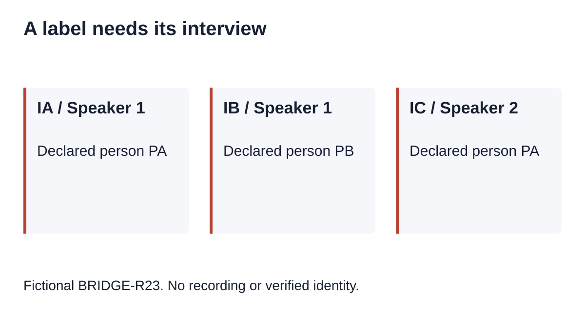
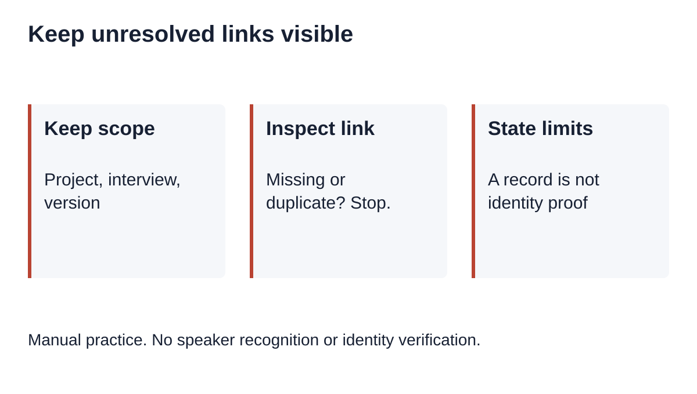

# Does Speaker 1 Mean the Same Person in Every Interview?

Canonical: <https://instascript.app/qualitative-speaker-label-scope>

No. In qualitative research transcription, a label such as Speaker 1 can identify a speaker within one transcript without identifying the same person in another interview. Keep the interview reference and transcript version with the local label. Link it to a project participant reference only when the project has an appropriate, documented basis; otherwise leave that relationship unresolved.

[Download the blank linking worksheet](/data/qualitative-speaker-label-scope-worksheet.csv) or [run the fictional exercise](/data/qualitative-speaker-label-scope-reproduce.cjs).

## What does the label actually identify?

A speaker label, a transcript reference and a participant reference answer different questions. The speaker label organises contributions inside a document. The transcript reference identifies the document being used. A project participant reference can connect a person's contributions across sessions when that relationship is established and its use is permitted. A shared label spelling does not supply that relationship.

Conversely, different local labels do not prove different people. A returning interviewee could have a different local label in a later transcript. Avoid both shortcuts: merging every Speaker 1 into one person and treating every changed label as a new person. Preserve what is known at each level instead of guessing from numbering, role, vocabulary or similarity of opinions.

[ATLAS.ti's formatting guide](https://atlasti.com/guides/interview-analysis-guide/transcription-formatting) discusses speaker identification and turn divisions. [UK Data Service guidance](https://ukdataservice.ac.uk/learning-hub/data-producer-support/preparing-data-for-sharing-and-reuse/documenting-and-describing-data/data-leveldocumentation/) calls for unique file identifiers, consistent speaker tags and documented relationships between materials. Our narrower contribution is the following authored collision exercise. Neither source validates the checker or supplies the fictional identities.

## Our fictional label-collision exercise

Everything below is invented teaching material called BRIDGE-R23. There are no participants, recordings, voice comparisons or listening sessions. The participant references are declared by the exercise's author so that you can inspect the bookkeeping. They are not observations about real people or evidence that any identity was verified.

**Card A:** Interview IA, transcript V1, Speaker 1, passage T01: “I used the side entrance.” Its declared practice mapping is person PA.

**Card B:** Interview IB, transcript V1, Speaker 1, passage T01: “I waited by the noticeboard.” Its declared practice mapping is person PB.

**Card C:** Interview IC, transcript V1, Speaker 2, passage T01: “I returned on Thursday.” Its declared practice mapping is person PA.

First compare A and B. Their local labels match exactly, but the supplied person references differ. Grouping the cards by the string Speaker 1 would merge two different fictional sources. No amount of consistent capitalization repairs that lost relationship: the missing part is the interview scope.

Now compare A and C. Their local labels differ, but the supplied person reference is the same. Treating each label string as a person would separate this fictional returning interviewee. These two comparisons demonstrate opposite errors. Neither establishes a method for identifying real returning speakers.

For the three authored cards, there are two distinct local label strings, three interview-and-label combinations and two declared participant references. The matching totals for local labels and participants are accidental. The membership is different: Speaker 1 groups A with B, while PA groups A with C. Comparing totals alone would miss the error.

Keep a passage's source tuple intact when moving it into a thematic worksheet: project, interview, transcript version, local speaker label and passage reference. Put any cross-session participant relationship in a separate mapping record. This preserves the original label even when the destination shows a project reference beside it. It also lets a reviewer ask which mapping version supported that association.

## Our unresolved fourth card

Add Card D: interview ID, transcript V1, Speaker 1, passage T01: “The corridor was quiet.” The practice supplies no mapping for it. The intended outcome is unresolved, not PA, PB or a newly invented participant. A missing mapping is an absence of a declared link in this exercise; it is not evidence that the person is new or absent from the project.

Next propose a second mapping for Card A that points to PB. The checker refuses the lookup because two rows match its source tuple. It does not choose the first, the latest or the most plausible person. Even duplicating the original PA mapping produces a duplicate-record refusal. That conservative rule is explicit here; another workflow would need its own documented reconciliation policy.

Try using the V1 mapping against an IA/V2 transcript. The checker leaves the relationship unresolved because this fixture contains no V2 mapping. A revision may preserve the speaker assignment, or it may correct it. The old association therefore needs an explicit review or mapping to the new version; our example does not decide that question automatically.

Finally change the project reference while keeping IA, V1 and Speaker 1. The lookup again remains unresolved. Familiar-looking references from another collection cannot silently satisfy the request. This is a record-consistency example, not an access-control mechanism or proof of anonymity.

## What the runnable check establishes

The standalone Node exercise embeds these four cards and mapping rows. It makes no network request and reads no research recordings. Its saved output records the misleading label groups, the declared participant groups and the refusal cases. Run it and compare the output with [the saved example](/data/qualitative-speaker-label-scope-example.json).

The fixture also uses structured field arrays rather than joining identifiers with an unescaped separator. Two different field pairs can produce the same naive joined string if a field contains that separator. The check demonstrates this small collision separately. Avoid interpreting a successful string lookup as evidence of identity: even a correctly constructed key only retrieves a declared record.

A mapping in this exercise requires a decided state and a nonempty basis field before retrieval. Those are administrative requirements. A person could type a false basis that passes the check. The output cannot authenticate a reviewer, determine consent, recognise a voice, verify a participant, or prove the factual sufficiency of a real linking decision. No external analysis application was tested.

## Use the blank worksheet without filling gaps by guesswork

The worksheet separates source project, interview, transcript version, local label, passage, proposed participant reference, link status, basis and unresolved question. Start with source fields. Leave the participant field blank when its relationship is unknown. Use the project's actual approved records and process to document a real decision; do not copy any fictional reference from this page into research evidence.

Keep identity keys and restricted information in the project's approved storage. A pseudonym or composite reference does not make a transcript anonymous, and this worksheet neither grants permissions nor protects a sensitive mapping. Decide what can be shared under the actual study's rules. This guide offers no instruction to collect names, biometric voiceprints or additional identifying information.

## How this differs from the existing exercises

The [wording and speaker review guide](https://instascript.app/qualitative-review-purposes) separates two decisions within a passage. The [counting-units exercise](https://instascript.app/qualitative-transcript-counting-units) begins with supplied person identifiers and examines formatting and counting. This exercise addresses the earlier association between a transcript-local speaker label and a cross-session participant reference. The [reported-speech guide](https://instascript.app/qualitative-reported-speech) addresses a different source relationship inside a person's turn.

## Can InstaScript make these links?

No. InstaScript prepares editable English speech drafts from browser-decodable local media up to 100 MB; it does not identify participants, perform speaker recognition or maintain a research identity registry. First use loads model resources, and cached resources can still require initialization. This is a manual guide, not an automatic linking feature.

Local file processing and subtitle edits remain in the browser. Public Instagram URL fetching involves servers and possible fallback services. YouTube tools retrieve existing captions; successful lookups may be cached for one hour. Read the [privacy explanation](https://instascript.app/privacy) before choosing a route for permitted material.

## Questions answered directly

**Does the same Speaker 1 label establish the same person?** No. Retain its interview scope and document any separate cross-session relationship.

**Do different labels prove different people?** No. The fictional A and C cards demonstrate the opposite possibility; a real relationship needs appropriate evidence.

**Does an unresolved link mean a new participant?** No. It means the relationship has not been established in the record being used.

**Does a passing script verify identity?** No. It checks declared records and counterexamples only. It does not perform listening or identity verification.
