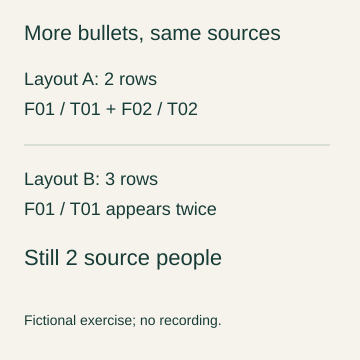
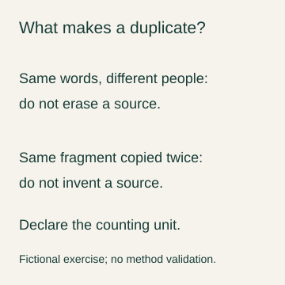

# Do Transcript Bullets Count as More Research Evidence?

No. Splitting one answer into three bullets creates three display rows. It does not create three interviewees or three independent interviews. Keep the source person and turn attached to each bullet, and name the unit counted before reporting a number. A count of formatted excerpts answers a different question from a count of participants.

This qualitative research transcription exercise uses invented text only. There is no recording, participant, human listening test or recognition run. It demonstrates a narrow bookkeeping problem, not a recommended counting method for every qualitative study. Choose your analytic approach before deciding whether any frequency table belongs in the report.

## Try two layouts of the same words

In fictional STEPS-R17, person F01 supplies turn T01: “The stairs were steep. The signs were small.” Person F02 supplies T02: “The signs were small.” These sentences were authored for this exercise. They are not quotations from a study or a source webpage.

Layout A has two rows: one row for the complete T01 and another for T02. Layout B divides T01 at the sentence boundary and leaves T02 intact. It has three rows. Nothing was added to the interview corpus. There are still two fictional people and two turns. Joining the two T01 fragments with one space reconstructs its original text exactly.

Now copy the stairs bullet into a second worksheet tab and combine the tabs. There are four rows, while the number of source people remains two. The copied row is useful as a deliberate trap: a tally of displayed rows can grow through a clerical operation. Repeated display is not additional testimony. This is an arithmetic observation in the saved fixture, not evidence about how often researchers make this mistake.

A second trap is subtler. The two signs sentences have identical wording, but they come from different fictional people. Removing duplicates solely by text would erase one source. Keeping every row without its provenance would count a copied stairs row twice. A defensible duplicate rule needs an explicitly chosen identity; identical wording alone cannot decide it.

## Record the counting question before changing layout

Write the intended claim in ordinary language. For example: “How many distinct fictional people mention signs in these two supplied turns?” Its denominator is the two supplied people, not the number of bullets. Both people have a signs sentence. That statement applies only to the authored fixture. It supplies no population estimate, prevalence claim or real finding.

A different question, “How many displayed rows contain the word signs?”, gives two rows in both layouts here. That accidental agreement does not make row counts equivalent to people counts. Replace a response with two signs sentences and the relationship can change. Inspect the unit definition rather than relying on one matching total.

Use separate fields for person, source turn, transcript version, displayed fragment, fragment identity, analysis label and counting unit. Keep a copied-display marker when a fragment appears more than once. Store a decision about which appearances contribute to which table. This worksheet is manual documentation; it does not validate a research design or decide whether a passage supports a theme.

## What the runnable example actually checks

The accompanying Node script creates both layouts from the same two authored turns. Twelve assertions check row totals, stable person and turn totals, exact reconstruction, the deliberate duplicate case, the loss caused by text-only deduplication, and the distinct identities behind equal wording. The saved JSON shows the complete strings and counts. A passing result says that these tiny data structures follow the declared rules. [Download the Node exercise](/data/qualitative-transcript-counting-units-reproduce.cjs) and [saved output](/data/qualitative-transcript-counting-units-example.json).

It cannot establish semantic equivalence, determine whether punctuation changes meaning, select a coding unit or show that a qualitative software package handles identifiers correctly. The exercise uses person, turn and text together only for these supplied strings; repeated identical wording within the same turn would need stable occurrence identifiers. No external analysis application was imported into, and no speed or accuracy measurement was performed. Before using another program, declare and test its actual import behavior separately.

## Keep formatting choices separate from reporting choices

[ATLAS.ti's clean-transcription guide](https://atlasti.com/guides/interview-analysis-guide/clean-transcription-research) discusses paragraphing, speaker labels, project conventions and checking against recordings. Its [formatting guide](https://atlasti.com/guides/interview-analysis-guide/transcription-formatting) covers speaker turns and source references. These are existing topics, not discoveries of this article. [Harvard Library](https://guides.library.harvard.edu/c.php?g=796889&p=10476360) relates transcription choices to the study's methodology. Our narrower contribution is the authored two-layout and copied-row counterexample, which keeps row totals and source totals separate without prescribing a coding unit.

## Use the draft within its limits

InstaScript can prepare editable English drafts from browser-decodable local media up to 100 MB. It does not identify research participants, count themes or approve analytic claims. Model resources download on first use; cached resources may still need initialization. Local files and edits remain in the browser. Instagram lookup uses servers; YouTube tools retrieve existing captions, and successful queries may be cached for one hour.

## Does this recommend counting themes?

No. [Nicmanis (2024), in the section on counting analytic strata](https://journals.sagepub.com/doi/10.1177/16094069241236603), discusses quantification within reflexive content analysis and makes its use conditional on the methodological and epistemological approach. That section also cautions that a more frequent account is not necessarily more important. Those are method-specific limits, not a universal endorsement of counting across qualitative approaches. Our arithmetic exercise does not establish that your project should quantify themes.

If your approach does not call for counts, keep the source identifiers for traceability and omit the tally. If a report uses a count, state what it counts and preserve enough provenance to reproduce that count. The fictional strings here establish no research findings.

[Download the practice worksheet](/data/qualitative-transcript-counting-units-worksheet.md). Read the [existing guide to selecting evidence and context](https://instascript.app/qualitative-coding-evidence) for the separate question of what text supports a code.
