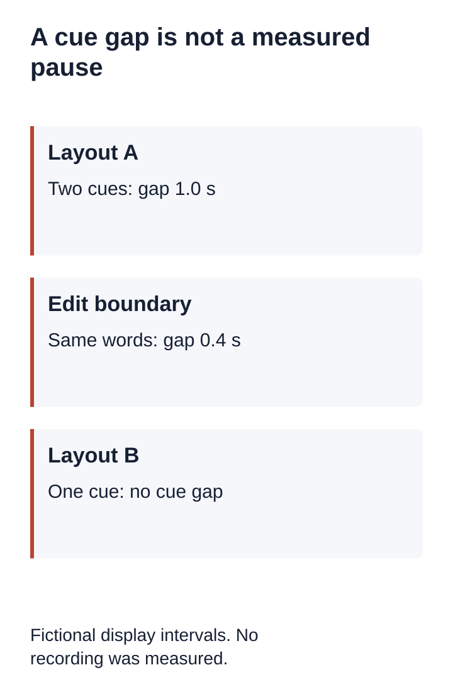
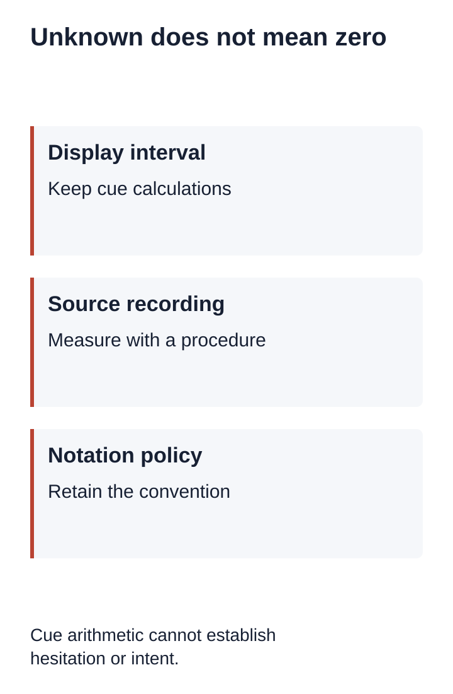

# Can a Subtitle Gap Measure an Interview Pause?

Do not treat a gap between subtitle cues as a measured pause in qualitative research transcription. Keep it as a cue-boundary calculation until a declared measurement procedure checks the recording. A comma, an ellipsis and a blank interval between cues are different kinds of representation.

[Download the pause review worksheet](/data/qualitative-transcript-pause-measurement-worksheet.md)

## Fictional exercise: the same words, two cue layouts

Everything below is authored training material. There is no participant, recording, listening check or recognition run. These numbers demonstrate arithmetic and information loss; they do not measure a person's silence.

Layout A places “I waited” in a cue ending at 4.0 seconds and “Then I left” in a cue beginning at 5.0 seconds. The gap between the displayed intervals is 1.0 second. Layout B uses one cue from 2.0 to 7.0 seconds containing “I waited. Then I left.” Both contain the same words in the same order, after ignoring punctuation. Layout B has no between-cue gap to calculate. That absence does not demonstrate continuous speech.

Now imagine that Layout A's first cue ends at 4.6 seconds instead. Without changing a word, the calculated gap falls to 0.4 seconds. This exercise changes only fictional display boundaries. It cannot tell which boundary, if either, matches the end of speech. Naming the column “pause duration” would turn an editing convention into an unsupported observation.

## Keep three fields separate

Record the cue interval in a display field. Keep a measured recording interval, if one is actually obtained, in a separate field. Record the notation convention in a third field. A marker can refer to a project's category without supplying an exact duration. An absent marker can reflect the transcription policy rather than an absence of silence.

For this fictional worksheet, record Layout A's gap as “1.0 seconds between cue intervals; acoustic status unknown.” Record Layout B as “not available from between-cue arithmetic.” Do not enter zero. Zero would assert a value that this representation does not provide.

## Before comparing interviews

Ask whether both transcripts were prepared under the same conventions and whether those conventions preserve the detail needed by the research question. If one file has punctuation only and another has timed annotations, record the difference before creating a numerical comparison. Recovering the original recording and defining a suitable procedure may be necessary. This guide does not prescribe a universal silence threshold or a conversation-analysis notation system.

The worksheet should capture recording version, transcript version, cue IDs, cue-boundary calculation, notation policy, recording-review status, measurement procedure and unresolved limitations. Preserve unknown values explicitly. Do not infer hesitation, discomfort or agreement from this arithmetic.

## Copy the review worksheet

| Field | Value |
|---|---|
| Recording / version | |
| Transcript / version | |
| Cue IDs and display intervals | |
| Calculated cue gap | |
| Transcription notation policy | |
| Recording reviewed? | Not reviewed |
| Acoustic interval and procedure | Unknown |
| Reviewer / date / limitations | |

## What the exercise checks

The downloadable Node fixture checks alternative layouts, normalized word sequences, missing measurements, invalid intervals and overlapping display intervals. These are checks of invented data. They neither validate a silence detector nor establish what a speaker intended.

InstaScript does not offer validated research pause measurement. Speech recognition is English-only and accepts browser-decodable audio or video up to 100 MB. Local files and subtitle edits remain in the browser. Existing draft timestamps provide replay locators, and subtitle editing changes text and timing manually. No research recording is needed for this exercise. Do not upload private interview material to reproduce it.

## Why the source convention matters

The W3C WebVTT specification defines cue start and end offsets and allows cues to overlap. It does not certify a cue boundary as a measured speech boundary. Our inference is that subtracting these offsets alone cannot establish an acoustic pause.

The UK Data Service example transcription instructions use ellipses for hesitation and pauses and also for unfinished statements. This is a project example, not a universal notation rule. Its relevance here is the need to retain the convention before treating a mark as a measurement.

## Related resources

- [Qualitative research transcription](/qualitative-research-transcription)
- [Subtitle Editor](/subtitle-editor)
- [Privacy](/privacy)
- [Download the fictional Node exercise](/data/qualitative-transcript-pause-measurement-reproduce.cjs)
- [WebVTT cue timing specification](https://www.w3.org/TR/webvtt1/#webvtt-cue-timings)
- [UK Data Service example transcription instructions](https://dam.ukdataservice.ac.uk/media/622355/UKDA-example-transcription-instructions.pdf)
