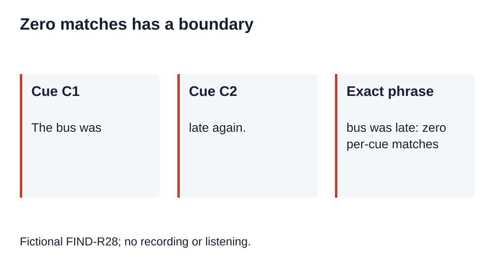
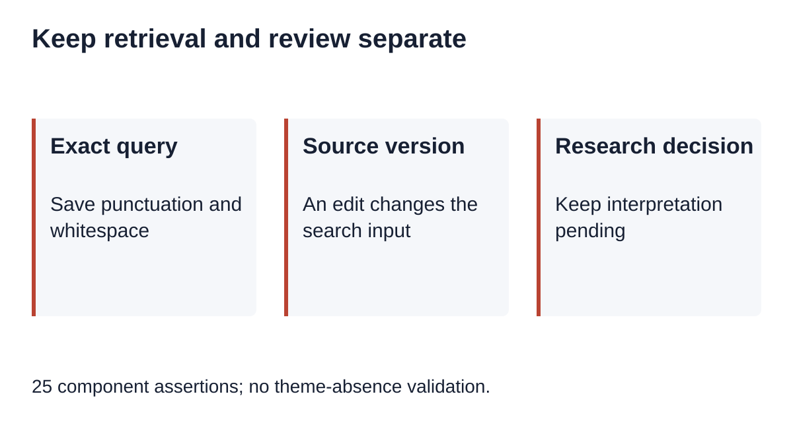

# No Transcript Search Matches: Check the Search Boundary

Canonical: <https://instascript.app/qualitative-transcript-search-limits>

No. A zero-result transcript search means the current search did not find the entered characters within its search units. It does not establish that an interview never addressed the topic. Check the transcript version, cue boundaries and alternative wording, then review the relevant context before making a research claim.

[Download the search review worksheet](/data/qualitative-transcript-search-limits-worksheet.csv)

## What did the search actually inspect?

InstaScript's shared transcript search looks for literal character sequences in the current edited words, separately inside each cue. It ignores differences between ASCII uppercase and lowercase letters. It does not join cues, expand synonyms, interpret a question, or assign themes. A failed phrase search therefore has a narrower meaning than an absent topic. A successful match also needs interpretation: matching letters can occur within a larger word.

For qualitative research transcription, keep retrieval and analysis as separate decisions. A query can locate a passage worth reading without deciding what that passage means. An analyst can identify a relevant passage that contains none of the original query's words. The worksheet below records the technical observation and the analyst's follow-up separately, leaving interpretation pending.

The [Harvard recording guide](https://guides.library.harvard.edu/c.php?g=796889&p=10476360) links transcription choices to a study's methodological approach and calls for manual revision of automatic output. The [ATLAS.ti annotation guide](https://atlasti.com/guides/interview-analysis-guide/annotated-interview-transcripts) describes contextual notes and review before analysis. These general principles already exist. Our contribution is the particular inspectable retrieval exercise below, not a new theory of qualitative analysis.

## Our component experiment: invented text, real search function

Everything in FIND-R28 is authored fictional training text. There is no participant, recording, recognition run or human listening check. On November 27, 2026, we ran the repository's actual findTranscriptMatches function in Node against these supplied cues. We retained the function's source hash, the input and the exact match positions. This is a component observation; browser keyboard interaction and a real recording are separate checks.

The four cues in fictional document FIND-R28 V1 are: C1, **The bus was**; C2, **late again.**; C3, **I waited forty minutes before it arrived.**; and C4, **I can't use the express line. The shuttle was unrelated.** No audio times are supplied, because the experiment needs only text. We do not invent a recording locator for these strings.

Searching **bus was late** returns zero matches: the characters are divided between C1 and C2. Searching **bus** returns one match in C1, and **late** returns two, one in C2 and one inside **unrelated** in C4. That second result is a literal substring match, not a second late-arrival statement. Read the displayed passage rather than treating the result count as the number of cases supporting a theme.

We then join the four cue texts with single spaces in a separate, explicitly derived text-only object. The same **bus was late** query returns one match there. This controlled change demonstrates a retrieval boundary in these invented inputs. It does not change the production search to span cues, establish speech timing, or approve joining arbitrary research passages. Keep the original cues alongside any derived reading view.

## Our counterexamples: wording, punctuation and revision

Searching **delay** returns zero matches, although the authored sentence about waiting forty minutes provides a passage a reader might consider when examining delay. That relevance is an exercise author’s interpretation, not something the search function detected. Alternative wording can help retrieve context, but making a long list of synonyms cannot prove that a topic is absent from an interview.

Searching **can't** with a straight apostrophe returns one match in C4. Searching **can’t** with a curved apostrophe returns zero. The component does not normalize these punctuation characters. Searching **BUS** still returns one match because its ASCII case folding is part of the implementation. Document the exact query instead of recording only a normalized-looking label such as transport search.

Whitespace is literal too. Our executed control uses **late ** with a trailing space versus ** late** with a leading space. The first matches the beginning of C2; the second returns zero because late begins that cue. Neither matches the letters inside unrelated. The downloadable output preserves the exact tested strings. A space that is hard to notice in a search box can therefore change the result.

Next, the exercise copies V1 to V2 and replaces only C2 with **delayed again.** Searching **late** now loses its C2 match but still finds the unrelated substring in C4. Searching **delay** gains a C2 match. This is an authored text edit, not a verified transcript correction. The old query record remains attached to V1; silently relabeling it V2 would hide a changed search input.

The experiment also confirms that searching leaves the supplied cues unchanged. It tests an empty query, a phrase present in one cue, ASCII case folding, the derived joined view and the version change. These checks describe only the supplied component and inputs. They do not establish theme detection, recall across real interviews, recognition accuracy, speaker identity or completeness of a study.

## Our worksheet: record an observation you can revisit

Use one worksheet row for each exact query and source version. Record the document reference, version, search surface, exact characters, count, returned cue references, follow-up passages and interpretation status. For the split phrase, a defensible technical record is: FIND-R28 V1, per-cue literal search, bus was late, zero matches. The research interpretation stays pending. The row does not say no transport problem occurred.

Download the [component runner](/data/qualitative-transcript-search-limits-reproduce.mjs) and [saved observations](/data/qualitative-transcript-search-limits-example.json). The runner takes the path to a local InstaScript source checkout and imports the actual search module after resolving its local dependency. It makes no network request and reads no research recording. Run it against the recorded commit to reproduce these observations; running against later code is a new observation with a new source hash.

For an actual project, review the relevant context under its approved method. If you alter a query, search surface or transcript, create another observation. Keep uncertainty visible when the source is incomplete. Our [partial review guide](/qualitative-review-scope) records which recording intervals were checked; this worksheet records what one text retrieval operation inspected. Neither record substitutes for the other.

## What does InstaScript provide here?

This is a manual research companion, not an automatic coding or semantic search tool. The [Audio to Text tool](/audio-to-text) makes editable English drafts from browser-decodable local media up to 100 MB. MP3, WAV, M4A, OGG, MP4, MOV and WebM support depends on browser decoding. First use downloads language-check and English recognition models; cached resources may still require initialization. Text search does not run recognition again.

Local files, edits and transcript search queries stay in the browser. Public Instagram fetching uses servers. YouTube tools retrieve existing captions and may cache successful queries for one hour. See [privacy](/privacy) for the separate processing routes and public-page analytics. Keep private research passages and participant details out of public search engines and public worksheets.

## Questions before using a zero-result observation

**Can a zero-result query support an absent-theme claim by itself?** No. It records a retrieval outcome under a particular input and search rule. Interpretation and source coverage require separate review.

**Does this change the shared search to join cues?** No. The joined text is a separate experimental input. The shared search remains literal, per cue and ASCII case-insensitive.

**Are the fictional sentences verified speech?** No. They were written for the component experiment. No recording, participant or listening verification exists.
