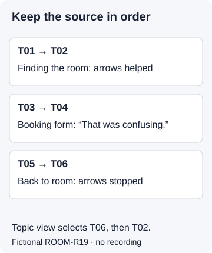
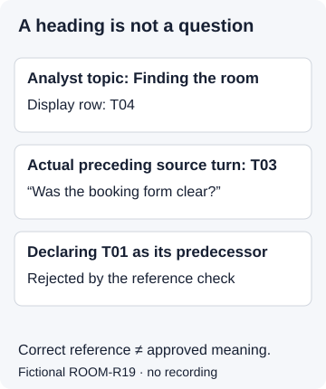

# Organize Interview Answers by Topic Without Rewriting the Conversation

Keep the chronological transcript intact and make a separate topic view that points back to its turns. A heading copied from an interview guide is an analyst's organizing label; it does not prove that every excerpt beneath it answered that question. Preserve the question or other turn that actually preceded each excerpt, even when the topic view changes its display position.

[Download the practice worksheet](/data/qualitative-transcript-topic-order-worksheet.md)

This qualitative research transcription exercise uses invented text only. There is no recording, participant or listening verification. It demonstrates a manual way to document a rearranged view, not an automatic topic classifier or a prescribed analysis method.

## Try a conversation that returns to an earlier topic

Fictional ROOM-R19, version 1, contains these six turns in this order. I is the interviewer and P is the participant role in this authored example; neither label identifies a real person.

T01 — I: How did you find the room?

T02 — P: The blue arrows helped.

T03 — I: Was the booking form clear?

T04 — P: That was confusing.

T05 — I: Anything else about finding the room?

T06 — P: The arrows stopped at the lift.

Suppose you put T02 and T06 under an organizing heading, Finding the room. That view brings two relevant passages together, but T02 and T06 were not consecutive in the source. The booking exchange occurred between them. A reader should be able to recover T01 before T02 and T05 before T06 without guessing from their new positions.

Now try a deliberately bad arrangement. Put T04 immediately below the heading How did you find the room? Its words remain unchanged, yet the displayed question can make “That” look like a comment about finding the room. In the supplied source, T03 immediately preceded T04 and concerned the booking form. The exercise exposes a change in apparent context caused by placement. It does not claim that a computer can determine what every pronoun means in a real interview.

## Give each topic row two different kinds of reference

For a row displaying T06, enter source ROOM-R19, transcript version 1, turn T06, and the exact supplied text. Enter Finding the room as the analyst's topic heading. In a separate field, enter T05 as the preceding source turn. The topic heading and preceding turn do different jobs. One organizes your analysis; the other helps a reader return to the exchange.

The filled row for T02 has the same topic heading but a different preceding source turn, T01. Keep both references when exporting the view. Do not replace the original IDs with row 1 and row 2: those numbers describe only the current display. A later sort could reverse them. Stable turn references remain attached to their source version.

For T04, keep T03 as its preceding turn even if you temporarily place the excerpt in a different topic bucket. A topic assignment may be tentative or disputed. Recording the actual preceding turn does not approve the bucket, establish the participant's intended meaning, or say that adjacency always indicates a direct answer. Inspect the wider exchange when the task requires it.

If a passage belongs under more than one topic, record multiple view references to the same source turn. Label them as appearances of one passage. The chronological source need not be rewritten to match each view. If you want to summarize instead, mark the summary as analyst-authored and retain its source references rather than presenting it as unchanged interview speech.

## Check the rearrangement before sharing it

The downloadable exercise constructs a Finding the room view in the deliberately reversed display order T06, T02. It resolves each reference against the six-turn source and recovers the selected turns in chronological order, T02, T06. That recovery contains only the selected turns; it does not reconstruct the full interview. The six-turn source is retained separately and remains unchanged.

The checks reject a missing turn, a different transcript version, altered copied wording and an incorrect declared preceding turn. For the bad T04 row, declaring T01 as the preceding source turn is rejected. Keeping T03 makes the reference mechanically consistent, while the topic assignment remains unapproved. This distinction prevents the check from pretending to make an interpretive decision.

There is also a boundary control: the first source turn has no preceding turn, so its reference uses an explicit null value. It does not borrow the last displayed row as context. These small refusal cases make the example reproducible. They are not tests of an analysis application's import behavior, recognition accuracy, or the validity of a research conclusion.

[Download the Node exercise](/data/qualitative-transcript-topic-order-reproduce.cjs) and [the saved example output](/data/qualitative-transcript-topic-order-example.json). Run the script with Node to reproduce its declared checks. It reads the invented strings bundled in the script and writes the example JSON beside it; no network request or research file is needed.

## Decide whether a topic view suits the study

Grouping excerpts is an analytic choice. [Harvard Library's recording and transcription guide](https://guides.library.harvard.edu/c.php?g=796889&p=10476360) connects transcription choices to the study's methodological approach. [ATLAS.ti's formatting guide](https://atlasti.com/guides/interview-analysis-guide/transcription-formatting) already covers speaker labels, turn divisions and source traceability. Those established topics are not discoveries of this exercise.

Our narrower contribution is the fictional return-to-topic conversation, the deliberately misleading placement of T04, and the two-reference worksheet with runnable refusal cases. It helps document how a secondary view relates to a source. It does not recommend rearranging every transcript, replace a methodological justification, or claim that chronology alone determines meaning.

Before sharing a topic view, state that its order is analyst-arranged. Retain the chronological source in the project's permitted storage. Resolve an excerpt's ID back to that source version and inspect its relevant surrounding turns. Check the permissions appropriate to the project separately. This public worksheet supplies neither secure research storage nor participant authorization.

## What does InstaScript do here?

This is a manual guide. InstaScript can prepare editable English drafts from browser-decodable local audio or video up to 100 MB; it does not identify participants, assign research topics or rearrange an interview into a validated question-and-answer record. Model resources download on first use, and cached resources may still require initialization. Local files and edits stay in the browser. Instagram fetching involves servers; YouTube tools read existing captions, and successful queries may be cached for one hour. See [privacy](/privacy).

For the separate decision about selecting evidence and context, use [the coding selection exercise](/qualitative-coding-evidence). For the distinction between display rows and source people, use [the counting-unit exercise](/qualitative-transcript-counting-units). Neither display position nor a topic heading should silently replace a source reference.
