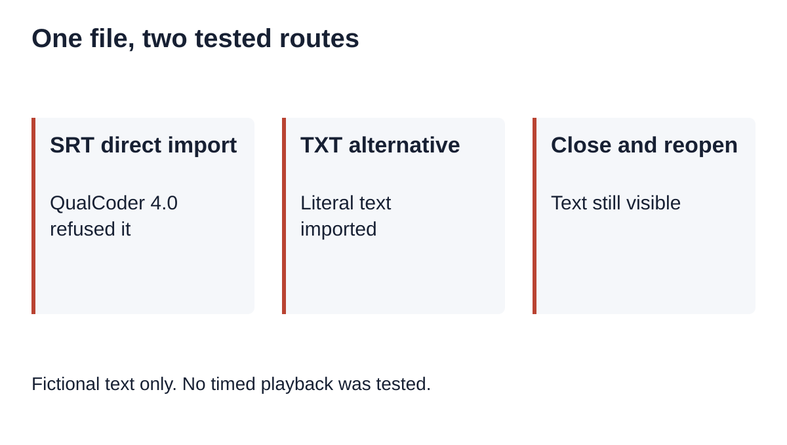
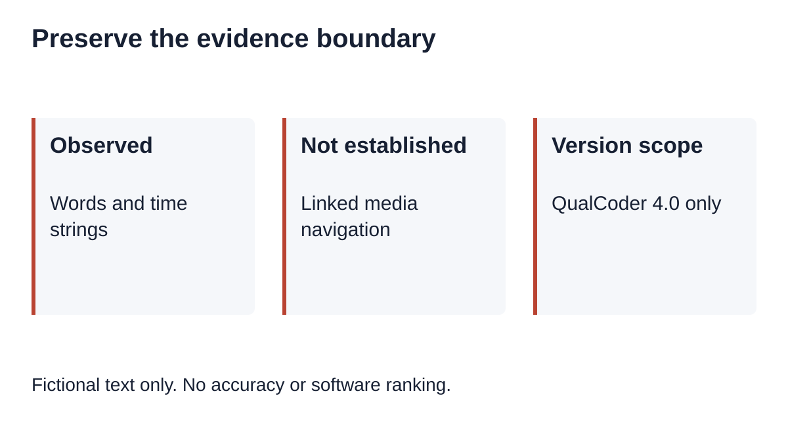

# Choosing Transcription Software: Test Required Evidence Before Scoring Features

Choose a transcription workflow by testing the requirements your project cannot do without. Use the same permitted sample, inspect the saved output in the intended destination, and retain failures and untested steps. A feature score cannot compensate for a failed requirement. No software winner has been established by the component exercise below.

## Declare a decision before trying the tool

Write down what must survive the workflow. If you need timed text in a particular analysis application, the requirement is not simply that a download button says SRT. Define what you expect to see after import: the required passages, usable times, and whatever source association your project needs. Check those observations separately. If speaker identities matter, require a speaker review step; do not treat a plausible name in generated text as evidence of identity.

Keep processing approval in its own field. An upload that technically succeeds does not establish permission to send study recordings to that service. Use permitted public material or an explicitly fictional text fixture for planning, and reserve private study material for an approved route.

Surrey's CAQDAS selection guidance supports considering the project, data and working needs and trying developer demonstrations. It is guidance about analysis software selection, not a validation of transcription engines. Harvard's recording and transcription guide connects transcription choices to the study's methodological approach and notes the need to revise automatic output. Neither source establishes a universal best product.

## Original exercise: the same component, two input conditions

This fictional workshop example contains no recorded speech. The first line is “The workshop opens on Friday.” The second is “Only if the room is available.” Invented cue ranges are 0–2 and 2.5–5 seconds. They are test inputs, not measured utterance boundaries or verified speech.

The declared component requirement is that both cue texts and both time ranges survive serialization and parsing. We executed the current InstaScript SRT serializer and its shared parser in Node. The complete input produced a 126-byte SRT file, and the parsed cues matched the input exactly. The linked sample and observation record expose the exact test input and its narrow result.

For the second input, we deliberately removed the second cue's end time. Export refused that input with a timing error. Under the declared requirement to deliver a complete timed file, this input cannot pass. Refusal is appropriate application behavior: the exercise does not mark the software defective or authorize inventing a missing time. Repair requires evidence for the missing boundary or a different, explicitly accepted requirement.

This is one component with two input states. These are not two products, two recognition runs or an accuracy comparison. Serializer and parser belong to the same implementation family. Agreement between them does not prove that a third-party importer handles the file correctly. The component roundtrip alone does not establish a browser download or external application result. The separate QualCoder observations below test a narrower destination route; speech recognition, speaker identity and processing approval remain untested.

## Keep the decision pending when evidence is missing

The original policy exercise treats every declared requirement as pass, fail or untested. One failed requirement makes the tested configuration ineligible under that requirement set. An untested requirement keeps the decision pending. Only when all required conditions pass does the policy call the configuration eligible for those declared conditions. Eligibility is not a market ranking or general endorsement.

The seven policy checks include a pass plus an untested downstream import, which remains pending, and a failed component requirement plus an untested import, which remains ineligible. Optional conveniences are deliberately absent from this decision. You can compare them after establishing the required conditions, while retaining the scope and date of every observation.

This differs from recording what plain text loses: the question here is whether the evidence is sufficient to make a selection decision at all. It also differs from checking an account's processing route. A route can be approved while an import requirement remains untested. A component can pass while policy approval remains unknown. Preserve those independent findings.

## Original destination observation: QualCoder 4.0, two routes

On November 14, 2026, we opened the official Windows portable release of QualCoder 4.0 and created a new, isolated project. The fixture contains no research participants or recording. We first chose Manage, Files, Import, selected All Files, and selected the exact 126-byte complete.srt created by our component experiment. The application displayed “Not supported file type” and “Cannot import file.” The project retained zero files. This direct-file route did not meet the declared requirement to import the two timed passages. It is not a test of recognition quality or every QualCoder import route.

Before a second test, we declared a different condition: preserve the literal text through plain-text import and a project close/reopen. We copied the same bytes to workshop-timecodes.txt. Its SHA-256 stayed 0d37291844c7cf85d1338a3b90afb0bb66579eeb4b518a6de326926344566043. This is an explicit change of input configuration, not a successful retry of direct SRT import.

The TXT file appeared as one imported file. Opening it showed both invented sentences in order and the literal ranges 00:00:00,000 --> 00:00:02,000 and 00:00:02,500 --> 00:00:05,000. We confirmed the text dialog, closed the project, reopened the same project directory, returned to Files, and opened the imported text again. The same sentences and timecode strings remained visible. That observation passes this narrow text-persistence condition. The strings were displayed in a text editor; we did not demonstrate clickable media locations, parsed interval objects or source-linked playback. There is no recording in the fixture to verify them against.

| Declared condition | Actual observation | Consequence |
|---|---|---|
| Direct import of complete.srt as the required timed transcript | Unsupported-file warning; zero imported files | This tested route fails that condition |
| Import workshop-timecodes.txt as literal text | Both sentences and timecode strings visible | Text-only condition passes on import |
| Preserve that text after project close/reopen | Same content visible after reopening | Narrow text-persistence condition passes |
| Navigate the correct recording from these timecodes | No recording; not tested | Remains untested |
| Actual browser-download artifact | Operator supplied the saved download; bytes matched; direct import was tested again | Artifact checked; direct SRT import still refused |

The desktop result changes a selection decision that a serializer/parser roundtrip cannot settle: an internally valid SRT can still be refused by a specific destination's direct-file importer. A plain-text alternative can preserve readable syntax without meeting a requirement for usable timed media navigation. Neither result identifies a universal best tool. Retain the failed condition rather than allowing a convenience score or a successful text-only path to erase it.

QualCoder's documentation describes a separate media-associated transcript path and SRT used alongside a video. We did not execute that path. Do not infer from this direct-file rejection that the application cannot work with timecoded transcription at all. The requirement record must name both product version and actual route.

## Actual download follow-up

On November 15, the operator supplied the saved file from a manual browser download. We read that actual file: 126 bytes, with the same SHA-256 as the component fixture. Both sentences and all four literal boundaries matched. We then selected that actual downloaded SRT in QualCoder's same file-import command. The unsupported-file warning appeared again; no new file was added. The existing TXT record remained separate.

This resolves access to the download artifact, with operator-assisted provenance rather than an automated download-event capture. The earlier event timeout remains in our record. The observed end-to-end attempt ends in a refused direct import; it is not a successful timed-import chain. Byte identity also connects this download to the separately tested TXT alternative, whose literal text persisted after project close/reopen. No playable recording association was established.

## Use a requirement record

For each candidate, record the exact workflow and version, requirement, test input alias, expected observation, actual observation, saved artifact, result, test date and next action. Keep fictional aliases separate from private study identifiers. The companion worksheet is blank by design; it does not invent comparative product results.

Before recommending a tool from this exercise, check any required speech, speaker and media-navigation behavior with permitted material. A rejected direct-import condition remains rejected. Keep untested candidates unranked. InstaScript's local-file speech recognition is English-only; this component exercise does not widen that language support or measure recognition quality or speed.

Sources: [Surrey selection guidance](https://www.surrey.ac.uk/computer-assisted-qualitative-data-analysis/resources/choosing-appropriate-caqdas-package), [Harvard recording and transcription](https://guides.library.harvard.edu/c.php?g=796889&p=10476360). Surrey/Harvard sources checked November 9; QualCoder documentation checked November 14, 2026. [QualCoder official documentation](https://qualcoder.org/doc/en/print/). The figures and worksheet are original; no human transcript verification is claimed.

## Download the exercise materials

- [Blank destination worksheet](/data/qualitative-transcription-software-test-worksheet.csv)
- [Fictional SRT sample](/data/qualitative-transcription-software-test-sample.srt)
- [Separate TXT alternative](/data/qualitative-transcription-software-test-sample.txt)
- [Observation record](/data/qualitative-transcription-software-test-observations.json)

Related: [plain-text export review](/qualitative-plain-text-handoff), [privacy](/privacy).
