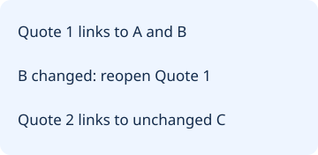
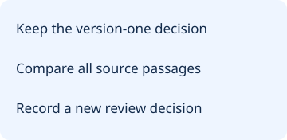

# Which Translated Interview Quotes Need Review After a Transcript Correction?

Reopen a translation review when any source passage it relied on has changed. Keep the previous decision with its original source versions. Carry it forward only after matching every source passage the decision used, including any passage that supplies a condition or exception.

[Download the review worksheet](/data/qualitative-translation-review-worksheet.md)

## Track the passages behind each translation

In qualitative research transcription, a report may display one sentence while the source interview supplies its meaning across multiple passages. A correction outside the first passage can change whether the sentence remains usable.

## Fictional exercise: the workshop key

This English-only simulation stands in for two languages. The source glosses are invented English descriptions, and no audio or translator was involved.

A team plans to quote a participant about a workshop. Passage A says the participant can use the key. Passage B supplies the access condition. Passage C, about the location of the sign-in sheet, supports a different quote. At version one, the record for A and B supports the report rendering “I can use the key after the supervisor arrives.”

Version two corrects B: the participant can use the key after the supervisor **calls**, which could be before the supervisor arrives. A and C retain their text and passage identifiers. The change in B is enough to reopen the translation review for the key quote. A separate review of the sign-in quote stays eligible for carry-forward because its recorded dependency, C, is present and unchanged.

| Proposed rendering | Source dependencies | Version two decision |
| --- | --- | --- |
| Key access | A and B | Reopen review. B changed from arrival to a call. |
| Sign-in location | C | Carry-forward eligible. C matched. |
| Key access with B missing | A and B expected, only A present | Block carry-forward until B is recovered or the evidence is reassessed. |

## Work the correction before editing the quote

Start with the original review entry. Write down the source transcript version, each passage identifier and the reporting draft version. Record the correction against passage B before rewriting the reporting sentence. If you change the sentence first and overwrite the old record, a second reviewer cannot see which wording the first review approved.

For the workshop example, ask a qualified reviewer whether the call is a permission signal or simply a time marker. The exercise does not settle that distinction. Keep the rendering pending until the decision and its basis are recorded. A revised sentence is a candidate until a reviewer checks it against both passages.

If a source identifier has been reused for two passages, pause the comparison. Repair or disambiguate the identifiers first. If the earlier record did not capture which passages supplied the condition, reconstruct the source links before deciding whether anything can carry forward.

## Copy this worksheet

| Field | Fill in |
| --- | --- |
| Reporting draft ID and quote ID | |
| Previous transcript version and passage IDs | |
| Current transcript version and corresponding passage IDs | |
| Changed, missing or ambiguous dependency | |
| Carry-forward eligible, reopened or blocked | |
| New reviewer decision, rationale and date | |

Use identifiers appropriate for the audience. Keep restricted transcript text and locators in the project’s approved records. The worksheet can travel with opaque IDs if the receiving reviewer already has authorized access.

## Can software check whether the translation is still accurate?

A comparison can flag changed or missing passages. The fixture below checks those states on invented data. A qualified human reviewer decides whether a rendering preserves meaning. InstaScript’s browser speech recognition is English-only. Its Subtitle Translator is a manual editor for supplied text. The speech tool accepts browser-decodable audio or video up to 100 MB and exports TXT, SRT or VTT. The manual subtitle editor opens local SRT or VTT and exports SRT. Local files and edits stay in the browser.

## Related resources

- [Qualitative research transcription](/qualitative-research-transcription)
- [Transcript correction and quote locators](/qualitative-transcript-corrections)
- [Manual Subtitle Translator](/subtitle-translator)
- [Privacy](/privacy)
- [Download the fictional Node exercise](/data/qualitative-translation-review-reproduce.cjs)
- [First steps in qualitative data analysis: transcribing](https://academic.oup.com/fampra/article/25/2/127/497632)
